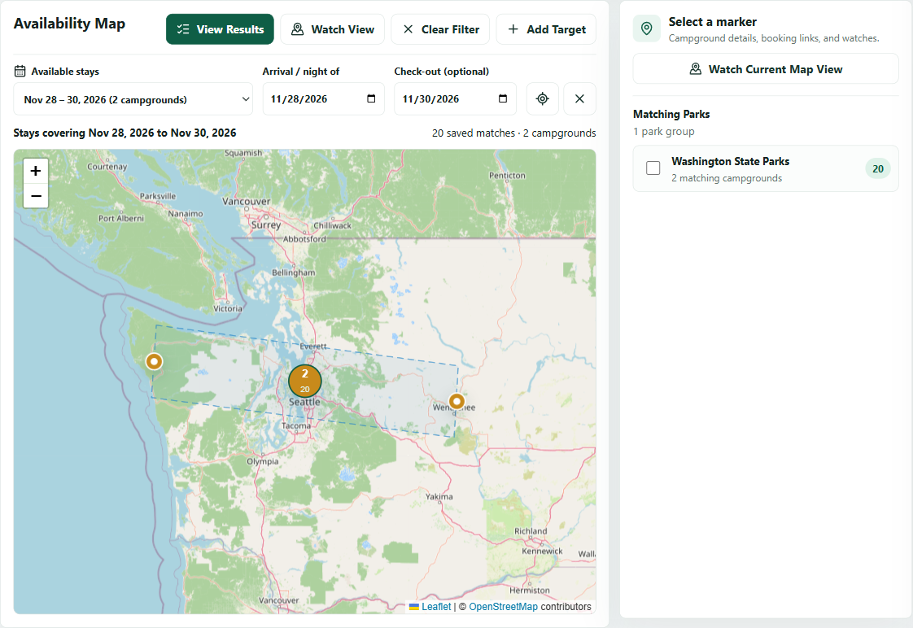
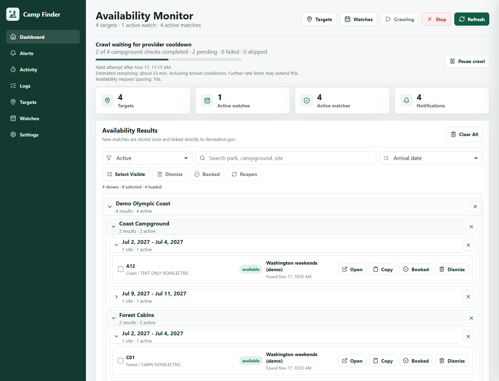
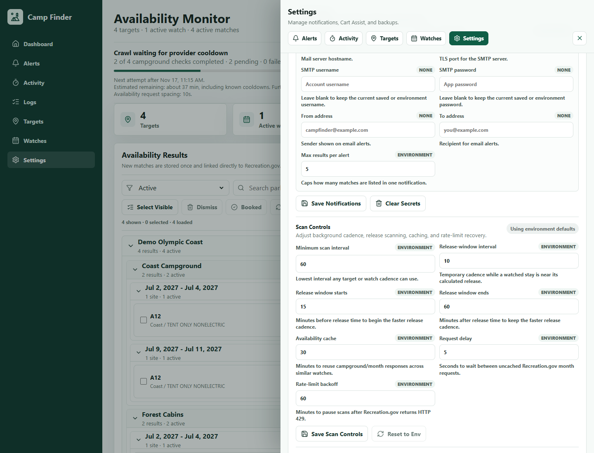
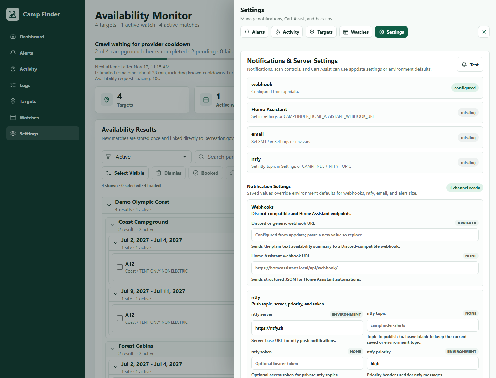
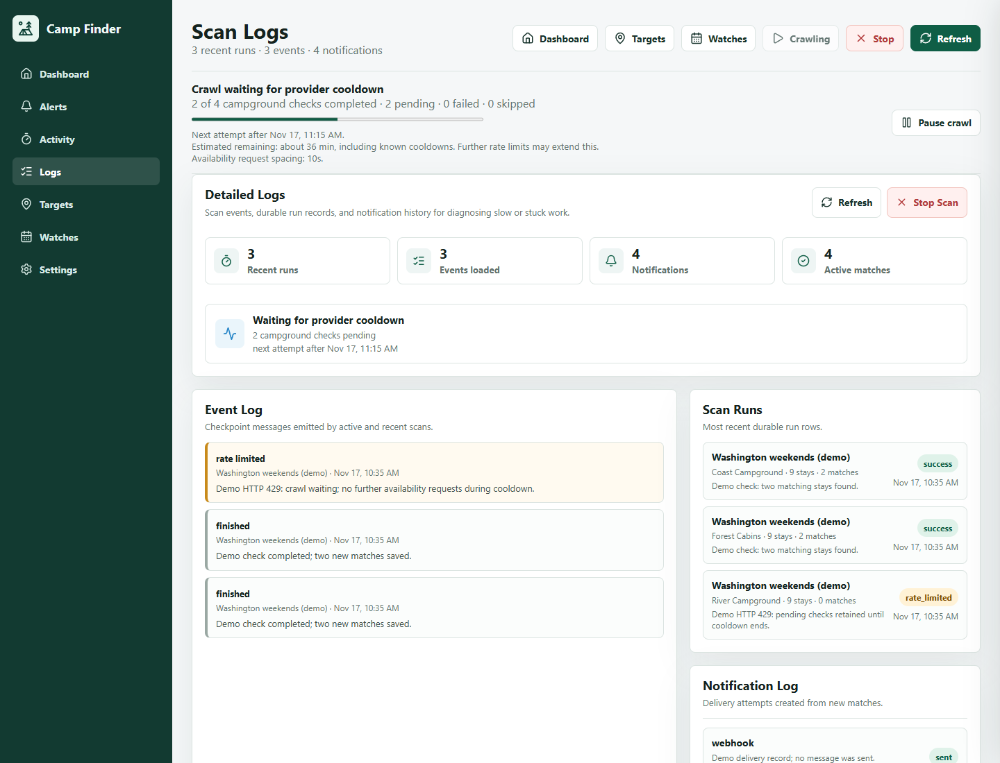

# Camp Finder

Camp Finder is a local-network web app for monitoring campground availability across supported reservation providers. Recreation.gov, Washington State Parks, Snohomish County Parks, King County's Tolt-MacDonald campground, and Skagit County's Howard Miller Steelhead Park are currently connected. It runs in Docker, persists its data in SQLite, and notifies you when a configured campground/date rule has availability.

Experimental native connectors also cover Tacoma Power Parks, BC Parks, Parks Canada,
Oregon Metro's Oxbow facilities, and a conservative ReserveCalifornia campground
catalog. See [provider coverage and setup](docs/camply-expansion.md) for verified
checks and limitations. No browser console or separate search worker is required.

The app is still notification-first. Matches link to the reservation provider, and Recreation.gov watches can be flagged as high priority for Cart Assist logging. The current Cart Assist implementation is a guarded audit trail and readiness check; it does not automatically click Add to Cart, submit payment, or try to get around login or CAPTCHA checks.

## Screenshots

Date-filtered availability map using saved local matches. Choose a night or a
check-in/check-out range, or select one of the stays already found by your watches.
Saved matches are not a guarantee that inventory is still available.



[Mobile availability map](docs/screenshots/availability-map-mobile.png) | [Date-map guide](docs/availability-map.md)

Grouped availability and a crawl waiting through a provider cooldown. The following earlier screenshots use synthetic data; the sites, progress, and delivery records are examples, not live availability.



[Mobile crawl status](docs/screenshots/crawl-mobile.png) | [Regional watches](docs/screenshots/regional-watch-demo.png) | [Regional coverage](docs/screenshots/regional-coverage.png) | [Notification settings](docs/screenshots/notification-settings.png) | [Scan controls](docs/screenshots/scan-controls.png) | [Logs](docs/screenshots/crawl-logs.png)

## Quick Links

- [Install on a server](#server-install)
- [First-run setup](#first-run-setup)
- [Continuous crawling and rate limits](#scanning)
- [Find a stay on the map](docs/availability-map.md)
- [Discord and other notifications](#notification-setup)
- [Backups](#configuration-backups) and [upgrades](#upgrading)
- [Troubleshooting](#diagnosing-api-failures)
- [Developer guide](docs/development.md)

## What It Does

- Add campground targets from Recreation.gov search.
- Discover and monitor Snohomish County campgrounds, including cabins and yurts, alongside federal campgrounds.
- Monitor King County's Tolt-MacDonald tent, RV, yurt, camping-container, and group sites as one campground target.
- Monitor Howard Miller Steelhead Park's public tent, RV, cabin, and Adirondack sites through Skagit County's calendar.
- Discover Washington State Parks Camping and Roofed targets, including cabins and yurts, and monitor them through the same watches and notifications without a browser console.
- Browse sources by region and manage saved campgrounds in collapsible park/county groups.
- Opt regional watches into future imports so new matching campgrounds join the same date and filter rules across connected providers.
- Import preset target packs for Pacific Northwest, Northern Rockies, Greater Yellowstone, or California national parks, then trim targets you do not want.
- Check preset packs against live Recreation.gov campground search and optionally import the discovered source list.
- Edit target display names, park/state labels, booking links, and day/week/month release-window settings.
- Detect a likely release window from Recreation.gov campsite reservation-window data when available.
- Pause and resume targets or individual watch rules without deleting them.
- Create watch rules with one or more arrival weekdays and a stay length, such as Friday or Saturday starts for two nights.
- Create the same watch across one campground, a park group, selected park groups, a state, or the active imported targets currently visible on the map.
- Create exact arrival/departure date watches.
- Edit watch names, targets, dates, day patterns, stay length, and site filters after creation.
- Filter watch matches by campsite type, loop text, site text, and minimum people capacity.
- Check equipment type and vehicle length for Recreation.gov and UseDirect targets; unknown fit never passes a length filter.
- Limit a watch to selected campsite IDs from previously loaded availability results.
- Continuously crawl due watches with a default 60-minute minimum between repeat checks and five-second spacing between uncached availability requests.
- Reuse fresh monthly responses, increase pacing after HTTP 429, and resume pending checks after the provider cooldown.
- Temporarily increase scan cadence around calculated release times.
- Queue every active watch with Start crawl and leave the server working after the browser closes.
- See completed, pending, failed, and skipped checks, the next retry time, and an estimated time remaining.
- Open the Activity drawer for scan run history, recent checkpoint events, and a manual Stop Scan control.
- Open the Logs page for a deeper diagnostic view of scan events, durable runs, and notification delivery.
- Revalidate previously available matches on each successful scan and remove matches that Recreation.gov no longer returns.
- Review recent scan activity, including candidate counts, matches, status, and messages.
- Calculate likely release windows from a target-specific booking window, release time, and timezone.
- Store availability matches once so notifications are deduped.
- Send a batch of new matches after each campground check, including partial discoveries before a rate limit.
- Mark selected watches as high priority with Cart Assist, then record one guarded assist attempt when a new match appears.
- Show Cart Assist server readiness and recent attempt history without exposing Recreation.gov credentials in the browser.
- Configure server-level Cart Assist from the dashboard or from Docker environment variables.
- Triage availability results as opened, booked, dismissed, or active again.
- Filter, sort, select, and bulk-update availability results from the dashboard.
- Filter the map by a night or full stay, or choose from saved available dates. Counts include all active matches, beyond the result list's 2,000-row cap.
- Inspect map markers with Recreation.gov descriptions, details links, Google Maps navigation links, activity tags, notices, and images when Recreation.gov provides media.
- Use visible park footprint polygons and Park Queue checkboxes to inspect and select campground groups directly from the map.
- Show notification channel status, configure delivery settings, and send a test notification.
- Notify by webhook, Home Assistant webhook, ntfy mobile push, and/or SMTP email when configured.
- Add Pushover, Telegram, or Twilio SMS through Apprise alongside existing channels.
- Export and restore targets, watches, scan controls, notification settings, and Cart Assist settings.
- Run as a single Docker Compose service on your local network.

## Dashboard Workflow

The dashboard is organized around the work that usually matters first:

1. Check the crawl banner and summary counts. Waiting means a provider cooldown is active, not that all campgrounds have been checked. Pause crawl retains pending work; Resume crawl continues it.
2. Choose a night, check-out date, or saved stay above the map. Matching campgrounds and park counts update together; View Results opens the matching stays below. Clear dates restores the full target map.
3. Open Watches to manage regional listings and their member campgrounds. Targets, Watches, Alerts, Activity, and Settings are slide-out drawers, not separate dashboard sections.
4. Expand park, campground, and stay-date groups in Availability Results, or use search and sort. Select Visible supports bulk actions; the X beside a group dismisses its active matches after confirmation. The Washington-centered map and Park Queue also support regional watches; Watch View still selects all active imported targets inside the map bounds, not just date matches.
5. Use Activity for recent scan checkpoints and Logs for detailed runs and notification delivery. Dashboard in the sidebar returns home from Logs.
6. Trip Control and the full-width release planner remain below the primary results area for planning the next trip.

In normal use, you add or import targets, create watch rules, then spend most of your time in the map, scan status, and results sections. Alerts, Activity, Targets, Watches, and Settings are slide-out drawers so the working area stays shorter. Release hints remain in a full-width planner below Availability Results, and the Logs link opens a dedicated diagnostics page when you need more detail than the Activity drawer shows.

## Preset Packs

The app currently ships with static park packs that were built from Recreation.gov campground search:

- PNW and Northern Rockies National Parks: Olympic, Mount Rainier, Crater Lake, North Cascades, and Glacier Recreation.gov campground facilities.
- Individual park packs: Olympic, Mount Rainier, Crater Lake, North Cascades, Glacier, Yellowstone, and Grand Teton.
- California National Parks: Yosemite, Sequoia/Kings Canyon, and Joshua Tree starter campgrounds.

Preset targets use campground IDs verified through Recreation.gov search results and include facilities whose Recreation.gov parent is the named park. A park pack does not include concession-run or non-reservable campgrounds outside that provider. The release settings remain editable because Recreation.gov booking windows can vary by facility. Bundled packs are under a collapsed section in Targets > Sources; they are fallback lists, not additional copies of saved targets.

The target drawer has three ways to use each preset:

- Import bundled list: imports the static fallback list that ships with the app.
- Check source: queries Recreation.gov search for each park in the pack and compares the live campground IDs against the bundled list.
- Import source list: imports the campgrounds returned by the live source check.

The source check is intentionally visible instead of automatic. It pages through Recreation.gov campground search for each park, keeps only exact parent-park matches, and verifies bundled campground IDs that the broad search misses. It shows how many campgrounds Recreation.gov returned, how many are new compared with the bundled list, and how many bundled targets were not returned by the current source search. That keeps the app useful when the network or upstream API is unavailable while still letting the campground lists drift with Recreation.gov over time.

Paused targets and watch rules are skipped by the background crawl and manual full passes. Their configuration is retained until resumed or deleted.

## Source Catalog

The Targets drawer separates **Sources** from **Saved** campgrounds. Source groups and bundled packs start collapsed. Saved campgrounds are searchable and grouped by their park or county; expanding a group exposes the existing edit, pause, open, and delete controls. Nothing is deleted or hidden from scanning by this layout change.

[Regional source catalog](docs/screenshots/county-sources.png) | [Grouped saved campgrounds on mobile](docs/screenshots/saved-targets-mobile.png)

Sources can be filtered to Puget Sound, Olympic Peninsula, Mount Rainier, Snoqualmie and Cascades, or Everett and North Sound. This filter narrows the source catalog, not a provider's import footprint. For example, Washington State Parks is a statewide source. Coverage is explicit:

- National parks: live Recreation.gov discovery for the requested Olympic, Rainier, Crater Lake, North Cascades, Glacier, Yellowstone, and Grand Teton set.
- National forests: live Recreation.gov discovery for Washington national forests such as Olympic, Mount Baker-Snoqualmie, Okanogan-Wenatchee, Gifford Pinchot, and Colville.
- Regions: a Washington Recreation.gov state starter for federal campgrounds that are not covered by a named park or forest source yet.
- County and regional parks: Snohomish County, King County's Tolt-MacDonald campground, and Skagit County's Howard Miller Steelhead Park have live discovery and exact-stay availability searches. Tacoma Power and Oregon Metro have experimental native connectors. Clallam and Lewis remain unconnected; Jefferson County camping is directory-only.
- Washington State Parks: live GoingToCamp Camping and Roofed targets, using the adapted GoCamp/Camply workflow. Local Docker checks include camping and a browser-confirmed two-night cabin match. WA DNR remains directory-only.

The [Washington State Parks setup guide](docs/washington-state-parks.md) covers
the direct API path. It runs inside the regular Camp Finder container without
credentials, a browser console, or another service. The old browser diagnostic
prototype has been [retired](docs/browser-worker.md); existing profile data is not
deleted by an upgrade.

Sources labeled **Live monitoring** or **Experimental API** have Check and Import actions. Check discovers campgrounds from that provider; Import creates or updates targets by provider-qualified ID. Experimental does not mean verified live coverage. Washington access denials persist across restarts, disable Check/Import, and require review before resetting in Sources. **Not connected** and **Directory only** entries cannot be imported into the scanner. An official listing or an open park does not establish nightly campsite availability.

For Washington API failures, open **Logs > Provider Diagnostics**, or use the log icon beside the source. Expand a request to inspect its HTTP status, timing, response classification, and proxy/header-presence flags. The download button exports the latest redacted report without contacting the provider. Cookies, authorization values, raw bodies, and proxy addresses are never included. See [diagnosing denied requests](docs/washington-state-parks.md#request-diagnostics) for the comparison procedure and current findings.

### Snohomish County Setup

1. Open Targets > Sources > County and regional parks.
2. Import Snohomish County Parks. The live directory currently includes Flowing Lake, Kayak Point, River Meadows, Squire Creek, Wenberg, Whitehorse, Lake Roesiger Group Camp, and Evergreen State Fairgrounds RV Park.
3. Create a park-group watch for **Snohomish County Parks**, or include those targets in a Washington or selected-groups watch. Friday arrival plus two nights covers Friday and Saturday.
4. Leave site type blank for all accommodation types, or enter `cabin` or `yurt`. Results use the county's site-type labels; utility campsites may allow tents without having "tent" in their type name.
5. Configure Discord or another alert channel in Settings. County matches use the same results, grouping, dismissal, and notification workflow as federal matches. Booking links retain the campground and both stay dates; select the named site on the county page to complete booking.

The county connector makes read-only searches without account credentials, and checks the full stay rather than combining individual open nights. It respects provider minimum stays, closures, and booking windows through the returned search results. It does not submit a Reserve button, hold a site, or use Recreation.gov credentials. Cart Assist and automatic release-window detection are not supported for county targets. See the county's [campground directory](https://www.snohomishcountywa.gov/1082/Campgrounds) and [reservation policies](https://snohomishcountywa.gov/1263/Rules-Policies-Regulations).

Each provider has a separate persisted cooldown. A Recreation.gov 429 leaves its checks pending while eligible county checks continue. County searches are paced and cached using the UI scan controls, and imported county targets default to hourly repeat scans. Missing, denied, or unrecognized provider responses are errors, not evidence that previous matches are booked.

Some county directory coordinates are rounded to whole degrees. Those coordinates are omitted instead of placing a misleading marker. Campgrounds without coordinates still participate in county park-group and state watches, but not map-view watches. County details currently link to the provider page; local photo and amenities enrichment is not connected.

### King County Setup

1. Open Targets > Sources, select Puget Sound or Snoqualmie and Cascades, and expand County and regional parks.
2. Import King County Parks. Tolt-MacDonald appears as one target; its individual tent, RV, yurt, container, and group sites are discovered from the live provider catalog rather than added as separate targets.
3. Create a King County park-group watch or include the target in a Washington/map-view watch. Use Friday arrival and two nights for a Friday/Saturday weekend. Existing regional watches only gain new imports when Include future imports is enabled for the matching area.
4. Use `yurt`, `tent`, `RV`, `container`, or `group` as the optional site-type filter. A camping container is not labeled as a cabin or yurt. Leave the filter blank for every overnight type.
5. An alert opens the site's campground section on King County's reservation map. Re-enter the arrival/departure dates there and choose the named site. The map does not preserve dates in the verified URL format. Sign-in and checkout remain on the county website; Camp Finder does not place a hold.

The [published camping policy](https://kingcounty.gov/en/dept/dnrp/nature-recreation/parks-recreation/king-county-parks/rentals/camping) requires two to seven nights and describes an April-October camping season. Camp Finder also checks each candidate site's current reservation-system restrictions. Those may be stricter than the general page: during development, the container's reservation record required ten days' notice while the general page said five. Resident and non-resident windows must both permit the stay; account-specific exceptions are not assumed. Partially available stays are not reported as matches.

The first eligible scan can take several minutes while site rules are checked. Catalog and rule responses are cached for 24 hours in memory. Availability uses the normal stay cache setting. King County requests are serialized with at least five seconds between requests, and a higher UI request-delay setting still applies. Logs identify catalog, availability, and rule-check requests. ETA is approximate and can be less accurate during this initial metadata load. No account credentials are needed for monitoring.

### Skagit County Setup

1. Open Targets > Sources, select Everett and North Sound or Snoqualmie and Cascades, and expand County and regional parks.
2. Import Skagit County Parks. Howard Miller Steelhead Park appears as one target covering its public campsites, cabins, and Adirondack shelter. Other Skagit County campgrounds are not included in this connector.
3. Create a county-group watch, or include it in a Washington or map-view watch. Enable Include future imports on an existing matching regional watch to have the target join automatically.
4. Leave the site-type filter blank for every accommodation, or use `tent`, `RV`, `cabin`, or `adirondack`. For Friday and Saturday nights, select Friday arrival and two nights.
5. Follow an alert to the county calendar, re-enter the dates, and select the named site. No verified date-prefill URL is available. Booking and account sign-in stay on the county website.

[Mobile source view](docs/screenshots/county-sources-mobile.png)

The [county campground page](https://www.explore.skagitcounty.org/skagitcounty/discover/facility/e43b2789-e411-426f-9d75-b53a499c11ba) opens each year's reservations in January and limits stays to 14 days. Camp Finder therefore searches current-year stays only, excludes same-day arrivals, and checks the calendar's live lead-time and stay-length rules. The current calendar specifies a two-night weekend minimum and a three-night holiday minimum. Camp Finder conservatively applies those minimums when any occupied night falls in that category; a holiday on checkout day does not count. Unknown rule formats produce an error instead of a misleading availability result.

Each stay is read in paced pages, with at least five seconds between requests. The UI request-delay setting can increase that spacing. All pages must be complete before matches are returned; hidden sites, partially open stays, and pending-only availability are excluded. The normal stay cache, provider-specific cooldown, logs, cancellation, and notification settings apply. This connector needs no credentials and never creates a cart hold. Availability is not a booking guarantee: the provider still checks your account, previous stays, accessibility needs, and other eligibility at checkout.

## Map and Region Watches

The map is both a navigation tool and a watch builder. Click a park marker or its footprint polygon to see a park summary, quick campground list, result counts, and a Watch Park button. Click a campground marker to load its Recreation.gov campground details, including description text, activities, amenities, active notices, a Recreation.gov details link, a Google Maps directions link, and a campground image when Recreation.gov returns one. Some Recreation.gov campground records do not include media, so the UI shows a simple placeholder instead of guessing with stock imagery. If Recreation.gov does not return a detail record or rate-limits that lookup, Camp Finder falls back to the saved target record instead of blocking the map panel.

Park regions are approximated from the visible campground coordinates in each park group. Camp Finder draws a convex campground footprint for groups with three or more distinct campground points, a corridor for two-point groups, and a small local footprint for one-point groups. Hovering a park row, park footprint, campground row, or campground marker highlights the matching item on the other side of the map/list pair. The Park Queue checkbox highlights that group's map footprint and adds it to the selected group set. Use Watch Selected to open the watch form with the Selected park groups scope and create one regional watch.

These local footprints are meant for watch selection, not legal park boundaries. A future boundary-source integration could use a provider such as Google Maps data-driven boundary styling, OpenStreetMap boundary data, or an official park boundary dataset, but that would need provider credentials, data licensing review, and a cache model before replacing the local campground-footprint polygons.

Park, selected-park, state, and map-view watches appear as one regional listing. Expand Campgrounds to inspect individual scan schedules, run a campground check, or pause a member. The group controls edit the shared dates and filters, select all members, pause/resume the region, or delete it after confirmation. A group edit applies to every remaining member. Creation and shared edits are atomic: a failed request does not save half a region.

By default, membership is the set of active imported targets selected when the watch is created. Check **Include future imports** to save a state, exact park-group names, or the current map bounds with the watch. When an active matching target is imported or updated later, it joins the same group and inherits its dates, filters, and Cart Assist setting. The selector is provider-independent: a Washington watch can include federal, Washington State Parks, Snohomish, King, and Skagit County targets. Preset-only markers and unconnected source directories are not monitored until a supported target is imported.

To upgrade an existing regional watch, open its group edit button, choose State, Park group, Selected park groups, or Current map view, enable Include future imports, and save. Saving also adds already imported active targets that match the chosen area. Existing members are retained if you change the inclusion area; remove individual members you no longer want. A saved map area does not move when you pan the dashboard map later. Map membership needs valid coordinates; state and park-group membership do not.

New members stay paused when all existing group members are paused. If only some members are paused, additions follow the enabled members. Deleting a member records an exclusion so reimporting the same campground does not undo that choice. Deleting the last member or the entire group removes the saved coverage. Turning Include future imports off keeps current members but clears that group's coverage and exclusion list. Turning it on again starts a fresh inclusion rule.

Group IDs, saved coverage, and exclusions survive configuration export/import. Old databases and old backups stay fixed-membership until you opt in. Ungrouped watches are unchanged. For automatically expanding groups, edit dates and filters through the group editor; individual pause/resume and deletion remain available. Logs record each automatic addition. The scanner still keeps a separate schedule and history for each campground, while dashboard watch counts represent regional listings. Newly added members enter normal background scheduling and respect their provider's pacing and cooldown.

Availability Results appears above the map and park queue on desktop and mobile. Existing watches and bulk actions appear before the collapsible Add Watch form in the Watches drawer.

Use the current map view scope for practical regions that do not line up with park or state names. Pan and zoom the Washington-centered map until the campgrounds you care about are visible, click Watch View, confirm the dates and filters, then save. A freehand polygon selector is not implemented yet, but the map-bounds scope covers the common "everything in this area for Friday and Saturday" workflow without adding another drawing mode.

Clallam County's official [Dungeness](https://www.clallamcountywa.gov/301/Dungeness-Recreation-Area) and [Salt Creek](https://www.clallamcountywa.gov/588/Salt-Creek-Recreation-Area) pages link to CampLife. A November 17, 2026 check found that availability required an account and a normal server request was denied. That connector remains disabled; saving an Olympic Peninsula map watch does not imply live Clallam coverage. Provider authorization and a verified supported integration are still needed.

## Source Roadmap

Camp Finder should keep treating Recreation.gov as the first-class source for federal campground targets. Recreation.gov publishes RIDB/API data for federal recreation areas, facilities, campsites, tours, and permits, and its own "Use Our Data" page encourages apps to consume those records and credit Recreation.gov. The current source-check buttons are the first version of that idea: they query Recreation.gov live, compare the response with bundled fallback targets, and can import the discovered campground list.

Source definitions describe coverage, grouping, and discovery capabilities. Provider-qualified campground IDs allow new reservation systems without renumbering existing targets or watches. Further expansion includes:

- National parks by parent park name.
- National forests and other federal lands by managing agency, recreation area, state, and region.
- Custom Recreation.gov searches for a state, region, or keyword.
- Washington state sources as their own provider family, not mixed into federal national-park packs.

Washington State Parks uses [GoingToCamp](https://parks.wa.gov/passes-permits/reservations/making-reservations). The connector incorporates Camply's working request behavior and PR #398's map/filter workflow into the existing backend. It uses a fixed provider host, serialized requests, anonymous in-memory cookies, a cached catalog, and exact-stay availability. No separate Camply service, browser console, or account is required.

The November 17, 2026 local Docker check discovered 75 Camping and 27 Roofed targets. For November 28-30 it returned 19 Bogachiel campsites and one Lincoln Rock Roofed match; the normal reservation website independently showed cabin C7 available for that stay. These are point-in-time matches, not reserved inventory. Production Unraid access still requires verification on that host.

Open **Targets > Sources > Washington state > Washington State Parks** and import the source. A Washington watch with **Include future imports** enabled adds the new targets automatically. Leave Site type blank for mixed Camping/Roofed watches; select Roofed targets for cabin/yurt searches. Names, individual cabin-versus-yurt types, loops, and capacities are not supplied by the availability endpoint, so unsupported filters report an error. Existing access stops survive upgrades: pause Washington watches, wait for any cooldown, then explicitly reset the reviewed stop and check the source. See the [state-park guide](docs/washington-state-parks.md).

[Tacoma Power Parks](https://www.mytpu.org/community-environment-parks/parks-recreation/reservations-fees/) uses its own GoingToCamp service. An earlier server-style request received a challenge; the current Camply-compatible connector subsequently passed catalog and exact-stay checks. It is available as an experimental source. See [current coverage and verification](docs/camply-expansion.md) rather than treating the earlier browser result as proof of API access.

Washington DNR publishes [campground GIS records](https://gis.dnr.wa.gov/site2/rest/services/Recreation/DNR_Recreation_Sites/MapServer/2), but [most DNR camping is first-come, first-served](https://dnr.wa.gov/recreation/find-your-campsite). County coverage also varies: [Jefferson's directory](https://jeffersoncountywa.myrec.com/info/facilities/default.aspx) includes first-come camping, while [Kitsap County does not permit overnight camping in its county parks](https://www.kitsap.gov/parks/Pages/FAQRules.aspx). State parks within Kitsap remain relevant through the state provider. Regional coverage must not manufacture availability for these directories.

## Watch Filters

Watch filters are optional. If left blank, Camp Finder reports every campsite that is available for the requested stay. If set, all populated filters must match:

- Site type: case-insensitive contains match against the provider's campsite type.
- Loop: case-insensitive contains match against loop name.
- Site text: case-insensitive contains match against site label.
- Minimum people: excludes known sites with lower max occupancy.

Leave Site type blank to include cabins as well as tent, RV, and other site types returned by connected providers. Where a provider supplies specific type labels, enter `cabin` for a cabin-only watch. For Washington State Parks, select Roofed targets instead; the connector cannot distinguish cabins from yurts. `tent` matches type labels containing that word; it does not infer tent compatibility from a utility campsite's amenities. Cabins must belong to an imported, active campground/facility covered by the watch; this does not search every lodging provider or hotel. A type filter is one substring, not a comma-separated list.

For a Friday-and-Saturday stay, select Friday as the arrival day and set two nights (Sunday checkout). Selecting both Friday and Saturday creates alternate starts, not a requirement to stay both nights.

## Cart Assist Boundaries

Recreation.gov says booking windows are set by individual facilities and lists booking-window details under each facility's Seasons & Booking tab. It also describes active bot mitigation and notes that Add to Cart holds a campsite for a limited checkout window. For that reason, Camp Finder keeps Cart Assist conservative:

- Cart Assist is off by default at the server and off by default on every watch rule.
- A watch must opt in before a new match can create a Cart Assist attempt.
- The server records at most one configured attempt per scan by default.
- A cooldown prevents repeated attempts from piling up.
- Credentials, if used, belong in the server `.env` file or in the dashboard-managed appdata settings, not in browser local storage.
- Attempt records can be marked opened, booked, dismissed, failed, or ready again from the dashboard.
- This build records readiness and manual-checkout attempts. It does not automate add-to-cart, submit payment, or bypass login, CAPTCHA, or any ambiguous Recreation.gov screen.

The retired Washington diagnostic console was never a Cart Assist implementation. Configuring credentials does not create a hold or enable automated checkout. Any future hold integration needs its own provider review and explicit opt-in; manual booking remains the supported workflow.

## Implementation Guide

Camp Finder is meant to run as one Docker service on a trusted local network or private VPN. The container serves the React frontend, FastAPI backend, background scanner, SQLite database, and static assets from the same port.

Use [compose.yaml](compose.yaml) on a remote server when you want to pull the published image from GitHub Container Registry. Use [docker-compose.yml](docker-compose.yml) when you are developing locally and want Docker to build from this checkout. Always specify `-f` when both files are present so the deployment uses the intended database mount and image.

### Server Install

Successful Docker workflow runs for pushes to `main` publish `ghcr.io/skestral/lynx-camp:main`. On the server, put the compose file and appdata folder in the directory where you want Camp Finder to live:

```bash
mkdir -p appdata/config
curl -fsSLO https://raw.githubusercontent.com/skestral/lynx-camp/main/compose.yaml
curl -fsSLo appdata/config/.env.example https://raw.githubusercontent.com/skestral/lynx-camp/main/appdata/config/.env.example
cp appdata/config/.env.example appdata/config/.env
nano appdata/config/.env
docker compose -f compose.yaml pull
docker compose -f compose.yaml up -d
```

Open `http://<server-ip>:8080` from a device on the same network. Do not expose the web UI directly to the public internet; the app does not include login protection yet.

Set `CAMPFINDER_APP_BASE_URL` in `appdata/config/.env` to the address you use from other devices, such as `http://<server-ip>:8080`, so alert links return to the right server. The Docker host must stay running; your browser and personal computer do not need to remain connected.

If GitHub Container Registry requires authentication on the server, run:

```bash
echo "<github-token>" | docker login ghcr.io -u skestral --password-stdin
```

### Local Source Build

For local development or testing changes from this checkout:

```powershell
docker compose -f docker-compose.yml up -d --build
```

Then open `http://localhost:8080`. Local source builds use the named Docker volume `campfinder-data` for the SQLite database. The server compose file uses `./appdata`, which is easier to back up and move between machines.

### First-Run Setup

1. Open the Targets drawer and import a preset pack or run a live source import.
2. Open the map, inspect target coverage, and import any preset-only campgrounds you want to scan.
3. Open Settings and confirm scan controls and notification channels. Save the notification settings, then use Test to confirm delivery before relying on unattended scans.
4. Open Watches and create a watch for one campground, a park group, selected park groups, a state, or the current map view. Use Friday arrival and two nights for a Friday/Saturday trip. Leave Site type blank to include cabins and tent sites.
5. Active watches are picked up automatically. Start crawl queues a manual full pass; a provider cooldown still takes precedence. You can close the page and check the crawl status later.
6. Use Download in Settings to save a configuration backup once targets, watches, and settings look right. Also back up appdata if you need results and history.

### Runtime Data

Keep `appdata/config/.env` on the server only. It is where file-managed notification secrets, SMTP credentials, ntfy tokens, and optional Recreation.gov credentials belong. Dashboard-saved settings are stored in SQLite at `appdata/campfinder.db` and override `.env` defaults.

Protect `appdata` the same way you would protect a `.env` file. Dashboard-saved secrets, including webhook URLs and Recreation.gov credentials, are not encrypted at rest. Recreation.gov credentials currently make the server status read as ready and allow guarded attempt records for high-priority watches; they are not used to complete checkout.

If you prefer file-managed Cart Assist defaults, set these in `appdata/config/.env`:

```text
CAMPFINDER_CART_ASSIST_ENABLED=true
CAMPFINDER_CART_ASSIST_COOLDOWN_MINUTES=30
CAMPFINDER_CART_ASSIST_MAX_ATTEMPTS_PER_SCAN=1
CAMPFINDER_RECREATION_GOV_USERNAME=you@example.com
CAMPFINDER_RECREATION_GOV_PASSWORD=your-password-or-app-secret
```

You can also configure Cart Assist from the dashboard. The dashboard only shows whether credentials are configured. It never prints the username or password. UI config exports omit saved secrets by default; use Include saved secrets only when you intentionally need a portable backup that contains credentials or webhook secrets.

### Development

See the [developer guide](docs/development.md) for virtual-environment setup, frontend development, tests, the scan API, and safe screenshot capture. Use a separate local database for development; do not point a second app worker at production appdata.

### Upgrading

Wait for the Docker publish workflow to succeed before pulling the new image. From the server directory, stop the container and back up the complete appdata directory, then update:

```bash
docker compose -f compose.yaml stop campfinder
tar -czf "campfinder-appdata-$(date +%Y%m%d-%H%M%S).tgz" appdata
docker compose -f compose.yaml pull campfinder
docker compose -f compose.yaml up -d campfinder
docker compose -f compose.yaml logs --since 5m --tail 100 campfinder
```

Keep that backup private because it contains settings and secrets. For a source build, use `docker compose -f docker-compose.yml up -d --build` after backing up its named volume; it does not use the server's `./appdata` bind mount. Editing a checkout or pulling Git changes alone does not replace a running container. Environment-file changes require container recreation, while saved Settings changes take effect without a rebuild.

After upgrading, refresh the browser, confirm the crawl status and notification channels, and review Logs. Existing environment values and saved UI overrides are preserved: upgrading does not automatically change an older one-second request delay to five seconds. Review Scan Controls and save the desired values. Do not reset a provider cooldown just to test an upgrade.

Existing databases receive the watch/history deletion indexes automatically during startup. No database reset, export/import, or manual SQL is required. The migration preserves targets, watches, results, and saved settings, including notification secrets. The first startup can take longer on a large database while indexes are built; allow it to finish before retrying dashboard actions. Keep a stopped-container appdata backup as described above.

The saved regional coverage table is also created automatically. Existing watches remain fixed-membership until Include future imports is explicitly enabled in their group editor.

Startup also adds notification-handoff and automatic-disappearance tracking to existing result rows. Old results are not queued for alerts again, and existing booked/dismissed choices are preserved. No database reset is needed for Washington support.

## Configuration Backups

The Settings drawer can download and restore a JSON config backup. A backup includes targets, watches, saved regional coverage and exclusions, target release settings, watch Cart Assist flags, scan control overrides, notification settings, and server-level Cart Assist settings. Availability results, scan logs, notification delivery history, Cart Assist attempt history, and the runtime crawl queue are not included. A stopped-container appdata backup preserves those records and the saved cooldown/pause state as well.

Saved secrets are redacted from downloaded backups unless Include saved secrets is checked before export. Redacted values stay on the server that created the backup, and importing a redacted backup does not erase existing saved secrets on the destination server. When Include saved secrets is checked, the JSON file contains stored Recreation.gov credentials, webhook URLs, ntfy topic/token values, and SMTP username/password values. Treat that file like a `.env` file.

## Scanning

Camp Finder scans active watches in the background and respects the minimum poll interval from the server scan controls. The `.env` values are the startup defaults, and the dashboard Settings panel can save appdata overrides for scan cadence, release scanning, request delay, caching, and rate-limit backoff. Saved dashboard values are stored in `appdata/campfinder.db` and take effect for new scans immediately. Use Reset to Env in Settings when you want the server to fall back to the `.env` values again.

The server continuously crawls due active watches, one campground at a time. Start crawl queues a full pass and returns immediately; the browser does not need to remain open. New hits are sent through configured notification channels after each campground check, including partial discoveries before a rate limit. If no channel is configured, the dashboard warns that matches are being saved without external alerts.

The crawl banner separates successfully checked, pending, failed, and skipped campground checks. A rate-limited check remains pending, and the queue resumes after cooldown without rechecking already completed campgrounds in that cycle. Queue progress, adaptive pacing, and cooldown deadlines survive a server restart. Runtime queue state is not included in configuration exports. Run only one application worker/container against a database.

The estimated remaining time uses the remaining campground/month requests, configured/adaptive spacing, observed request latency, and known cooldown. It is a planning estimate, not a provider guarantee: future 429 responses, retries, cache expiry, and database/notification work can extend it. For example, 312 campgrounds over three months can mean roughly 936 monthly requests. At five seconds between requests, spacing alone takes about 78 minutes before network time or cooldowns.

Release-aware scheduling uses target windows in days, weeks, or months. During the configured window around a calculated release, `CAMPFINDER_RELEASE_SCAN_INTERVAL_MINUTES` requests a shorter repeat interval. Defaults are 15 minutes before, 60 minutes after, and a 10-minute release interval. The global minimum still applies: with the default 60-minute minimum, the effective interval cannot drop to 10 minutes. Queue length and provider cooldowns can delay a check; this is not a guarantee of a request at the exact release time.

Camp Finder also has guardrails for off-season scans and rate limits. These can be changed from Settings without rebuilding the container:

- `CAMPFINDER_MIN_POLL_INTERVAL_MINUTES` defaults to `60`, so completed campground checks are not immediately repeated.
- `CAMPFINDER_AVAILABILITY_CACHE_MINUTES` defaults to `30`. Fresh monthly availability responses are reused across watches for the same campground/month.
- `CAMPFINDER_API_REQUEST_DELAY_SECONDS` defaults to `5`. This is a minimum pause after an uncached availability request completes, not a guarantee against rate limits.
- `CAMPFINDER_RATE_LIMIT_BACKOFF_MINUTES` defaults to `60`. A 429 pauses the crawl globally. The server honors the longer of Retry-After (seconds or HTTP date) and the configured backoff. Repeated limits double the local backoff up to 24 hours and increase request spacing up to 60 seconds. A longer provider Retry-After is never shortened. Successful full cycles gradually relax adaptive spacing toward the configured minimum.

While waiting, the scanner does not cycle through remaining targets generating repeated rate-limit records. The dashboard polls local progress less often during cooldown. Saved Settings overrides and existing `.env` values still take precedence over new defaults; update them when upgrading an existing installation.

The Target Settings form includes a Detect Window action. It samples Recreation.gov campsite reservation-window metadata for the selected campground and applies the most common window it finds, such as a 14-day rolling window when a facility exposes that rule.

For campgrounds with staggered releases, use View Profiles in Target Settings. It groups sampled Recreation.gov campsite metadata by loop, site type, and reservation window, which helps you decide whether a watch should filter to a specific loop and use a different day/week/month release window.

The scan status strip at the top of the dashboard changes as soon as a manual scan starts. While a scan is active, the dashboard refreshes scan runs, scan events, results, and Cart Assist attempts every few seconds so long Recreation.gov checks show which watch is currently running. It also uses recent scan-run records, so background scans that are still marked `running` can surface after the periodic dashboard refresh.

The Activity drawer is the first place to look when a scan appears stuck. It shows the current scanner state, recent durable scan rows, recent checkpoint events, refresh, a Logs link, and Stop Scan. The Logs page is the deeper diagnostic view. It shows the loaded checkpoint event stream beside recent scan runs and notification delivery, including events such as scan start, candidate count, Recreation.gov month fetches, available-site discoveries, rate limits, errors, and cancellation requests. If the server restarts while a scan row is still marked `running`, startup marks that row `interrupted` so the dashboard does not keep showing a stale process forever.

Pause crawl (or Stop Scan) pauses background crawling and asks the active request to stop at the next safe checkpoint. Pending checks are retained and Resume crawl continues them. The pause survives restarts and does not delete results or watch rules. A request already in flight may take until its HTTP timeout before stopping. Pausing an individual watch also makes it ineligible for future checks; resume it in Watches when needed.

| Crawl state | Meaning | What to do |
| --- | --- | --- |
| In progress | The server is checking the queued campgrounds. | Leave it running; new matches appear without waiting for the whole pass. |
| Waiting for provider cooldown | A 429 postponed unfinished checks. | Wait until the displayed retry time; repeated Start clicks do not bypass it. |
| Paused by you | Background work is stopped and the queue is retained. | Use Resume crawl when ready. |
| Incomplete | One or more campground checks failed. | Inspect Activity or Logs; failed checks are not successful completions. |
| Cycle complete | The pass finished without failed checks; skipped members are counted separately. | Due active watches continue to be scanned automatically. |

The minimum scan interval controls repeat checks, not how quickly a large region finishes. Request spacing controls the pace within a pass. Both are separate from the overall ETA. A configured five-second delay may display as ten seconds or more after adaptive backoff. Slower scanning reduces request pressure but cannot guarantee that a provider will accept every request.



## Booking Assist

Availability results link to their reservation provider and include status actions. Recreation.gov campsite links include the arrival date as `startDate`; the dashboard also adds it to older saved links before opening or copying them. Snohomish links preserve both stay dates. King and Skagit links open the provider map/calendar, where you must re-enter the dates. Open marks a fresh match as opened. Copy puts a booking brief on your clipboard with the campground, watch, site, loop, type, stay dates, and provider link. If the browser blocks clipboard access, the same brief appears above the results for manual selection. Booked records that you successfully reserved it, Dismiss removes it from active attention, and Reopen moves a handled result back to active availability. Future scans preserve booked and dismissed decisions for the same campsite/date result instead of notifying you about the same handled match again.

Each successful scan also revalidates active results for the same watch and date ranges. If a previously active site/date match is not returned again, Camp Finder marks it booked and removes it from the active list. Scan errors and Recreation.gov rate limits do not clear old results, because those runs did not prove the match disappeared.

An automatically removed match can become active and notify again when it reappears. This does not reopen a result that you explicitly marked Booked or Dismissed.

Results are grouped by national park, campground, and stay dates. When 12 or fewer results match the current filters, campground and stay sections open automatically so sites are immediately visible. Larger result sets start collapsed below the park level. Your explicit expand/collapse choices take precedence until the page is reloaded. The dashboard loads up to 2,000 recent result rows, shows server-side total and active counts, and warns if the loaded working set is clipped. Use the status filter and search field to narrow the dashboard before selecting results. Bulk actions apply to selected results only; Clear All dismisses every active availability result.

Each park/region, campground, and stay-date heading has an X button to dismiss that group's active matches. The confirmation shows the count. It includes collapsed rows but respects the current search/status filters and the browser's loaded working set; it does not dismiss unseen results beyond the 2,000-row limit. Booked results and watches are left unchanged. Use the Dismissed view to find those matches again and Reopen to restore them. Group dismissal is one atomic database operation.

The [dashboard screenshot](docs/screenshots/dashboard-overview.png) shows per-group dismissal beside campground and date headings. The [mobile watch screenshot](docs/screenshots/regional-watch-demo.png) shows a single regional listing with expandable campground members.

For high-priority trips, enable Cart Assist on the watch rule. When a new match appears, the scanner writes a Cart Assist attempt with one of these statuses:

- `off`: the watch is not using Cart Assist.
- `disabled`: the watch asked for Cart Assist, but the server feature flag is off.
- `needs credentials`: the server flag is on, but Recreation.gov credentials are not configured.
- `manual required`: the server is ready and the match should be handled in Recreation.gov manually.
- `opened`: the booking link was opened from the dashboard and still needs a final decision.
- `booked`: you successfully reserved the site.
- `dismissed`: you reviewed the hit and decided not to pursue it.
- `failed`: checkout could not continue or the page did not match expectations.
- `cooldown`: a recent attempt already happened and the cooldown is still active.
- `skipped`: the per-scan attempt cap has already been reached.

These records are shown on the matching availability result card and in the Settings drawer. They are intentionally boring and explicit, because a hold workflow needs a trustworthy log more than it needs surprises.

The Remote hold guard row in the dashboard shows the server's current Cart Assist state before a scan creates anything. `ready` means the server flag and credentials are set and no active checkout task is inside the cooldown window. `needs credentials` means the watch can ask for Cart Assist, but the remote server still needs Recreation.gov credentials. `cooling down` means a manual-checkout task is already active inside the cooldown window, and the row shows roughly when the next attempt can be prepared. `off` means the server-level guard is disabled.

The Checkout queue row is the fastest way to see whether Cart Assist needs attention. Active manual-checkout tasks are counted there and shown ahead of older attempt history, so a remote server can sit quietly until something actually needs a decision. If a ready task exists, Open Next opens its dated Recreation.gov booking link and marks the Cart Assist record as opened.

Use Open on the matching result card or on a ready Cart Assist record to open the Recreation.gov booking page and mark the attempt as opened. After you decide what happened, mark it Booked, Dismissed, or Failed. Booked and dismissed attempts also update the matching availability result, and resolved attempts no longer count against the cooldown. If an attempt was created before credentials were configured, use Ready after the server settings are fixed to make it an active manual-checkout task without creating a duplicate record.

## Map Provider

The dashboard map uses Leaflet with OpenStreetMap's public raster tile endpoint by default. The map keeps OpenStreetMap attribution visible. For heavier use, private deployments, or stricter tile-policy control, point the frontend at a different compatible tile service before building:

```text
VITE_CAMPFINDER_TILE_URL=https://tile.openstreetmap.org/{z}/{x}/{y}.png
VITE_CAMPFINDER_TILE_ATTRIBUTION=&copy; <a href="https://www.openstreetmap.org/copyright">OpenStreetMap</a> contributors
```

If you use the default OpenStreetMap tile service, keep the attribution visible and avoid prefetching or bulk tile downloads.

When a scan discovers several new site/date matches at once, Camp Finder sends one bulk alert instead of one notification per campsite. `CAMPFINDER_MAX_NOTIFICATION_RESULTS` controls how many examples appear in that notification and defaults to `5`; the rest remain visible in the results dashboard. If the watch uses Cart Assist, the alert includes the Cart Assist attempt note and a link back to the dashboard queue so you know the remote server has a high-priority task waiting.

## Notification Setup

Notification settings can be managed from the Settings drawer. Values saved in the dashboard are stored in `appdata/campfinder.db` and override the `.env` defaults for new notifications. Secret fields such as webhook URLs, ntfy topics and tokens, SMTP username/password, and Cart Assist credentials are write-only in the form: the dashboard shows whether they are configured but does not print the saved value back into the browser.

If you prefer file-managed defaults, set the same values in `appdata/config/.env` or in your local `.env`.

For a Discord-compatible or generic webhook, configure Webhooks in Settings or set:

```text
CAMPFINDER_WEBHOOK_URL=https://...
```

Discord webhooks work because Camp Finder sends a simple `content` payload.

### Discord Setup

1. Open Settings and find Notification Settings, then Webhooks.
2. Paste your Discord webhook into Discord or generic webhook URL and choose Save Notifications. The saved URL is not filled back into the input; the configured status and `appdata` source confirm it was stored.
3. Use Test at the top of Settings. This sends a test to every configured channel, including Home Assistant or email if enabled. Confirm that the message reaches the intended Discord channel.
4. Leave the server running. New matches are sent after each campground check; they do not wait for an entire regional pass to finish.

Configured means a value is present, not that delivery has succeeded. Adding a webhook does not replay every result already saved in the dashboard. Review the test response for connection errors, and use Alerts or Logs to inspect delivery records for actual matches.

New matches remain pending until the scanner hands them to the notification service. If cancellation, an error, or a restart interrupts that handoff, a later scan can notify when it sees the match again. Handled channel delivery failures are logged but are not automatically retried. A crash after an external service accepts a message but before the database acknowledgment can produce a duplicate alert.



### Other Channels

For Home Assistant, paste a webhook URL from a webhook-triggered automation into Settings or set:

```text
CAMPFINDER_HOME_ASSISTANT_WEBHOOK_URL=https://homeassistant.example.com/api/webhook/...
```

The Home Assistant channel receives structured JSON with `source`, `event`, `message`, `app_url`, match counts, and a bounded `matches` list. That lets an automation use the simple text message or route on fields such as campground, arrival date, and booking URL.

Discord and Home Assistant are independent channels and can be used together. Saving one does not replace the other. ntfy, SMTP, and Apprise can also be enabled alongside them.

For Pushover, Telegram, or Twilio SMS, enter up to ten Apprise URLs in **Settings >
Apprise destinations**, one per line, and save notifications. These URLs contain
credentials: saved values are write-only and excluded from normal configuration
exports. A blank field keeps the existing value; Clear Secrets removes saved
notification secrets and falls back to environment defaults. A single destination
can also be supplied as `CAMPFINDER_APPRISE_URLS`. See the
[setup examples and verification notes](docs/camply-expansion.md#additional-alerts).
The Test Notifications button sends real messages to every configured channel;
Twilio SMS may incur charges.

For ntfy phone push, subscribe to a private topic in the ntfy mobile app and set:

```text
CAMPFINDER_NTFY_SERVER=https://ntfy.sh
CAMPFINDER_NTFY_TOPIC=your-hard-to-guess-topic
CAMPFINDER_NTFY_PRIORITY=high
```

If your ntfy server requires a token, also set:

```text
CAMPFINDER_NTFY_TOKEN=...
```

For SMTP, set:

```text
CAMPFINDER_SMTP_HOST=smtp.example.com
CAMPFINDER_SMTP_PORT=587
CAMPFINDER_SMTP_USERNAME=you@example.com
CAMPFINDER_SMTP_PASSWORD=app-password
CAMPFINDER_SMTP_FROM=you@example.com
CAMPFINDER_SMTP_TO=you@example.com
```

`CAMPFINDER_MAX_NOTIFICATION_RESULTS` can also be changed in Settings. It controls how many match examples appear in one alert when a scan finds several new sites at once.

The Settings drawer shows which notification channels are configured and which values are missing. Use the test button after changing `.env` or saving dashboard values to confirm delivery before relying on background scans.

Blank secret fields preserve saved values. Clear Secrets removes the dashboard's saved notification secrets together; environment defaults can still supply them afterward. Keep webhook URLs, secret-inclusive exports, and screenshots of entered credentials out of issues and public repositories.

## Notes From OpenCamp

This project uses the same Recreation.gov availability pattern that makes OpenCamp useful: campground search plus monthly campground availability calls. Camp Finder wraps that idea in a persistent local web app with watch rules, release-window hints, dedupe, and Docker hosting.

## Managing Watches in Bulk

Open Watches and select the rules you want to manage. Pause Selected and Resume Selected change their scan eligibility together. Pause All stops future scans for every watch and requests cancellation of the current watch. Cancellation completes at a safe checkpoint; it does not interrupt an HTTP request already in progress.

Delete Selected and Clear All Watches require confirmation. Deleting a watch also removes its saved matches and scan history, but keeps the campground target. Pause watches instead when you want to keep their results. Stop an active scan and wait for it to finish before deleting watches.

Bulk and single-watch deletion run database work off the API event loop, so dashboard reads can continue while the transaction finishes. The crawler cannot start a new check during deletion. The selected deletion is atomic across all batches; a failed batch rolls back earlier batches. Deleted members are removed from the saved pending queue without clearing a provider cooldown or changing the global pause setting. If a browser request is cancelled, the server still finishes the transaction before allowing another scan. Refresh to check the outcome before submitting the deletion again.

## Diagnosing API Failures

The dashboard refreshes sections independently, so a failed settings request no longer hides successfully loaded availability. An error identifies the endpoint and HTTP status. Previously loaded sections remain visible but may be stale. Database lock failures return HTTP 503 with a retry hint; other database failures are logged by the server. The health endpoint checks database reads, not just whether the web process is running.

For repeated errors, collect `docker compose logs --since 30m --tail 200 campfinder` and check the host path mounted at `/data`. SQLite uses WAL mode to let readers continue during writes. Keep the database on a local disk, not an SMB/NFS mount or an actively cloud-synced directory. WAL does not fix damaged storage or a long-running writer.

A provider HTTP 429 is different from an unreachable Camp Finder API. With a 429, the local dashboard can remain healthy while the crawl waits. Check the retry time, pending count, and recent `rate_limited` event before restarting anything. Use Pause crawl to stop it intentionally; do not repeatedly restart or press Start to work around the cooldown. For local 500/503 errors, inspect the server log and storage instead.



Before troubleshooting storage or upgrading, stop the container and back up the entire appdata directory, including any `-wal` and `-shm` files. Do not delete journal files to clear a lock. Restart only after checking the logs and storage location. A healthy read probe alone does not prove that scans or writes are succeeding.

On Unraid, `/mnt/user/appdata/...` is a user-share view over local storage, not evidence of an SMB mount. Check the appdata share's actual pool/array placement, free space, mover/backup activity, and whether another container opens the same database. The path alone does not diagnose a lock. Do not copy between `/mnt/user` and a direct disk/pool path for the same files; see the [Unraid share documentation](https://docs.unraid.net/unraid-os/using-unraid-to/manage-storage/shares/). A traceback ending in `sqlite3.OperationalError: database is locked` confirms lock contention, but does not identify the process holding the lock or imply corruption.

## Next Useful Phases

The [Camply implementation guide](docs/camply-expansion.md) covers the new providers,
equipment filters, campsite selection, and alert destinations. The
[opportunity review](docs/camply-opportunities.md) records the original priorities
and remaining limits, including Yellowstone's 2027 transition. Tickets and timed
entry remain outside campground watches.

1. Add the remaining county reservation systems and broaden Washington accommodation metadata. Verify complete-stay camping and cabin coverage before enabling each source.
2. Add filters for equipment, max vehicle length, accessible sites, and electric/water hookups when the API exposes them consistently.
3. Persist source definitions and last source-check results in SQLite instead of keeping the catalog code-defined.
4. Add custom source creation for a Recreation.gov parent area, state, region, or keyword.
5. Add notification channels such as Pushover, Telegram, or richer email templates.
6. Evaluate a provider-supported Cart Assist integration separately from availability monitoring; keep checkout manual unless that integration is explicitly implemented and enabled.
