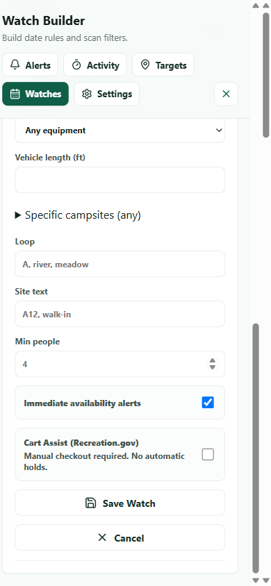
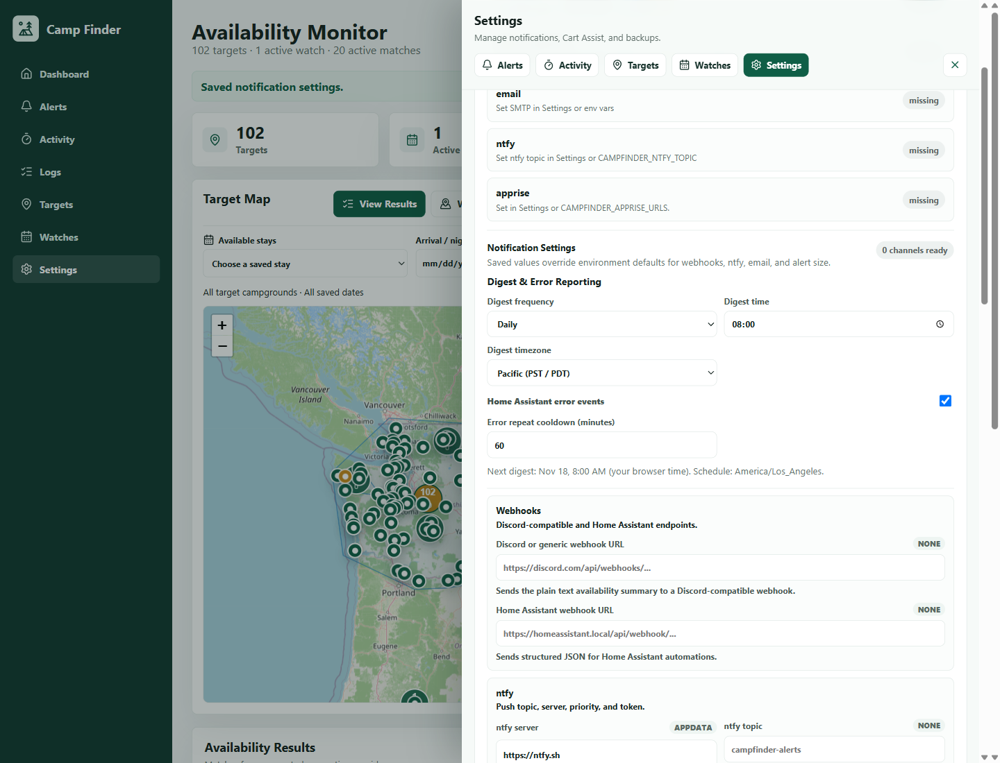

# Alerts and Digests

## Choose What Sends Immediately

Open **Watches**, create or edit a watch, and enable **Immediate availability
alerts** for searches that need your attention as soon as a match is found.
Regional group edits apply the choice to every member; automatically enrolled
campgrounds inherit it. A bell badge identifies enabled watches.



Existing and new watches default to off. Turning alerts off does not pause the
watch or discard matches. Its new discoveries still contribute to the digest.
Turning alerts on does not resend matches whose previous notification handoff
already completed. Immediate alerts go to all configured channels, not just
Home Assistant. Test Notifications remains an explicit test of all channels.

## Schedule a Summary

Open **Settings > Notification Settings > Digest & Error Reporting**:

- **Daily** is the default, at **08:00 Pacific**. It covers the previous calendar day, midnight to midnight.
- **Weekly** covers the preceding seven calendar days. Choose a weekday; Monday is the default.
- **Disabled** stops digests without changing immediate watch alerts or error reporting.
- **Pacific (PST / PDT)** follows daylight-saving changes. **Server time** follows the container timezone, which may differ from the Unraid host. **UTC** is also available.

The time input uses the selected schedule timezone. The next-delivery timestamp
is shown in your browser's timezone and labeled accordingly. Saved settings take
effect on the notification worker's next tick, normally within 30 seconds.
The worker runs even while the crawler is paused or waiting on a provider.



[Mobile settings view](screenshots/alert-settings-mobile.png)

Only **new or returning matches** enter a digest. A site continuously observed as
available does not repeat each day. A result automatically marked missing that
later reappears counts again; a manually booked or dismissed result does not.
Overlapping watches finding the same campground/site/stay are counted once per
digest period. Counts are grouped by park, campground, and stay dates. The number
of included groups follows Max results per alert; total counts are not capped.

A digest is a historical summary. Availability may have changed, and a discovery
may have since been booked or dismissed. Recheck the dashboard/provider before
booking. Empty periods produce a zero-match summary. Deleted watches/targets
remove their associated discovery history.

## Home Assistant Events

The webhook receives these routing fields:

| Event | `type` | Subtype | Meaning |
| --- | --- | --- | --- |
| `availability` | `alert` | `alert_type: availability` | New/reappearing matches from an opted-in watch |
| `digest` | `alert` | `alert_type: digest` | Scheduled summary across watches |
| `test` | `alert` | `alert_type: test` | Explicit test notification |
| `error` | `error` | `error_type: provider_rate_limited` | Scan postponed by a provider limit; severity `warning` |
| `error` | `error` | `error_type: scan_failed` | Failed scan with unknown availability; severity `error` |

All payloads include `source: camp_finder`, `message`, `app_url`, `severity`, and
`occurred_at`. Availability retains its existing `matches`, `match_count`, and
`included_match_count` fields. Digests include a stable `event_id`, frequency,
timezone, offset-bearing `period_start`/`period_end`, total counts, and bounded
`groups`. Period end is exclusive. Error events include provider, watch/target
IDs when known, a stable `event_id`, and `logs_url`.

For example, a Home Assistant template condition for availability only is:

```jinja2
{{ trigger.json.source == 'camp_finder'
   and trigger.json.type == 'alert'
   and trigger.json.alert_type == 'availability' }}
```

Use `trigger.json.alert_type == 'digest'` for summaries, or
`trigger.json.type == 'error'` for operational notifications. Existing automations
that filter on `event == 'availability'` continue to receive that event name.
An automation without an event filter will receive all enabled event types.

**Home Assistant error events** is a separate toggle, enabled by default when
that channel is configured. **Error repeat cooldown** defaults to 60 minutes,
per provider and error subtype. Different providers/types can each report once.
The suppression record survives restarts. These operational events are not gated
by a watch's availability-alert checkbox and are sent only to Home Assistant.

Error payloads contain a safe summary, not raw exception text, webhook URLs, or
account details. Logs contains the underlying scan diagnostics. Delivery errors
also omit secret destination URLs. An unreachable/stopped Camp Finder server
cannot report its own outage; use an external health check for that case.

## Delivery and Recovery

Daily/weekly delivery has one durable attempt per period and channel. The attempt
is recorded before contacting the destination. Restarting after a missed time
attempts only the latest eligible period, not a backlog of daily messages.
Enabling or changing the schedule starts with its next future occurrence.
Enabling error reporting starts with new scan errors, not historical failures.

Handled delivery failures appear as `error` in **Logs > Recent notifications**.
An interrupted scheduled/error attempt becomes `unknown` on restart because the
remote service might already have received it. These attempts are not automatically
resent; this avoids repeated summaries or error floods. Check the destination and
use Test Notifications to verify repairs. Other configured digest channels still
receive their own attempt. Immediate availability alerts retain their existing
notification handoff/revalidation behavior.

Spring-forward delivery times that do not exist move forward by the DST gap;
repeated fall-back times use the first occurrence. Calendar windows may span 23
or 25 hours, rather than a fixed 24. One application worker/container must own the
database and scheduler.

## Install and Upgrade

Keep the existing `/data` volume when deploying the image. Startup adds the watch
flag, discovery journal, and delivery ledger with the needed indexes. It does
not reset watches, results, secrets, or pause/cooldown state. Existing watches
start with immediate alerts off. Review their flags after upgrading.

Discovery history starts at upgrade; old results are not backfilled. New/returning
discovery timestamps are written in the same transaction as the result. Journal
and scheduled/error delivery history are retained for 90 days. A full database
backup retains this history and duplicate-suppression state. JSON configuration
export/import includes watch flags and digest/error settings, but not runtime
history or dispatch state. Secrets remain opt-in in exports.

UI settings override environment defaults. Docker Compose passes these variables:

```dotenv
CAMPFINDER_DIGEST_FREQUENCY=daily
CAMPFINDER_DIGEST_TIME=08:00
CAMPFINDER_DIGEST_TIMEZONE=America/Los_Angeles
CAMPFINDER_DIGEST_WEEKDAY=0
CAMPFINDER_HOME_ASSISTANT_ERRORS_ENABLED=true
CAMPFINDER_HOME_ASSISTANT_ERROR_COOLDOWN_MINUTES=60
TZ=UTC
```

Weekdays are Monday `0` through Sunday `6`. The server-time option uses `TZ` when
set, otherwise the container's local timezone. Set `TZ=America/Los_Angeles` on an
Unraid container when that should also be its server timezone. Pacific schedules
do not require changing `TZ`.

## Development

`alert_schedule.py` computes timezone-aware calendar periods. `alert_dispatcher.py`
owns the separate notification loop, error cursor, and per-channel claims.
`availability_findings` records only new/reappearing results; `notification_dispatches`
records scheduled/error attempts. These are separate from per-result availability
delivery records, and the notifications endpoint combines both for the UI.

`test_alert_policy.py` covers opt-in behavior, migration, export/import, regional
inheritance, discovery deduplication, previous-day boundaries, DST, weekly/server
time, disabled schedules, restart suppression, failure visibility, and redaction.
Tests use synthetic responses and never contact an alert destination.

Local verification on November 17, 2026 used the existing Docker test database,
with crawling paused and no notification channels configured. Desktop (1440px)
and mobile (390px) browser checks covered settings persistence, weekly/server-time
and disabled schedules, and regional alert opt-in. The screenshots are from that
local instance. Delivery tests use fake HTTP/SMTP/Apprise transports; they do not
establish delivery to a real Home Assistant or Discord instance.
