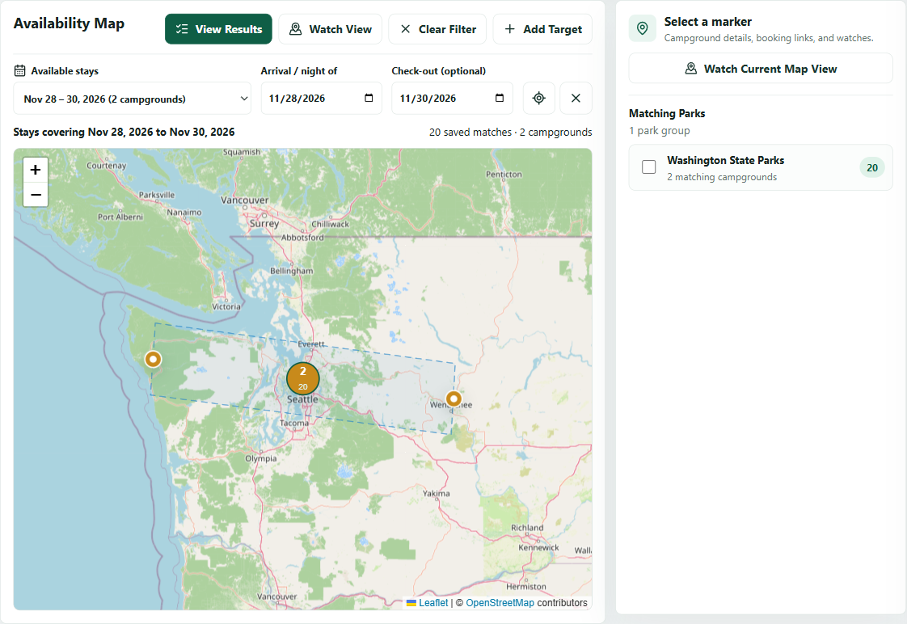
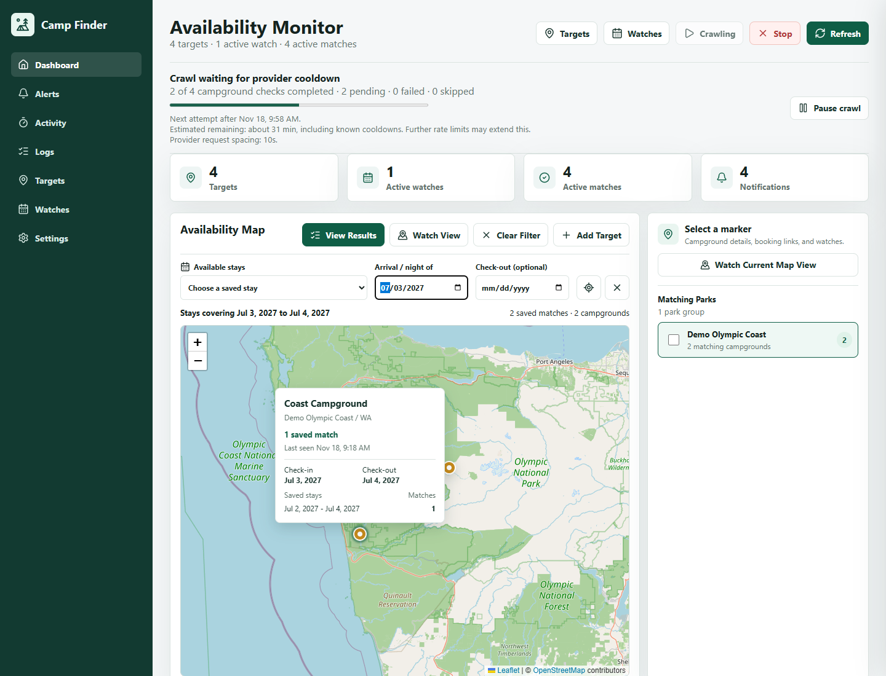

# Find Availability by Date

The dashboard map sits above Availability Results. It starts with the full target
map, centered on Washington. Date choices filter saved results; they do not start
a scan, change a watch, send an alert, or reserve anything.

## Choose Dates

- **Arrival / night of** with an empty check-out shows stays covering that night.
- Add **Check-out** for a continuous stay. Friday arrival and Sunday check-out
  includes Friday and Saturday nights, not Sunday night.
- **Available stays** lists distinct arrival/check-out pairs already found by
  watches, along with the number of campgrounds for that saved date pair.
- **Fit matching campgrounds** recenters the map. **Clear dates** restores all
  target markers and removes the date filter from the results list.

The map and Matching Parks list show only campgrounds with active saved matches
covering every selected night. Clicking a campground narrows the results to that
campground and stay. View Results opens the list without losing the date filter;
Map and dates returns to the map. Dates survive a trip to Logs and back during
the same browser session, but are not saved as watch configuration or in backups.

[Mobile layout](screenshots/availability-map-mobile.png)

## Preview a Campground

Hover or keyboard-focus a campground marker to see its name, park/state, saved
match count, last observation time, and up to three saved stay pairs. Each date
row includes its match count; additional date pairs are summarized below it.
With map dates selected, the preview includes only saved stays covering the full
selection. Counts include all matching records, even beyond the Detailed list's
2,000-row cap. They are matches, not unique sites or a new availability check.

The preview stays open while the pointer is over its marker or the card. Escape
dismisses it. On narrow maps the card can scroll, keeping its marker, zoom
controls, and map attribution accessible. Tap a marker on a touch device to open
the preview and the existing campground details panel. Clicking still selects
the campground and filters results; hovering does not change the selection.

Hover reads the dashboard's saved aggregate and makes no additional API or
provider requests. Full descriptions, images, booking links, and Google Maps
links remain in the details panel. A failed availability refresh retains saved
unfiltered counts with a stale-data warning; a failed date-filtered map shows
its existing availability error state instead of guessed matches.

Region polygons stay hidden until you select a park from the side list or map,
or check its Park Queue checkbox. Hovering a region highlights its markers but
does not reveal an outline. Choosing a campground alone does not add a region
polygon. Clearing the location selection hides its outline; checked regions stay
outlined until unchecked. These are approximate campground footprints, not
official park boundaries.

[Mobile preview](screenshots/map-hover-mobile.png)

## What a Match Means

One saved campsite result must cover the entire interval. The app never joins
different sites, separate watches, or partial nights to claim a continuous stay.
Booked, dismissed, and inactive matches are excluded. Counts are saved matches,
not unique physical sites: overlapping watch rules can record the same site more
than once. Campground counts are distinct.

A longer saved stay can cover a shorter selected interval, but that does not prove
the shorter stay satisfies a provider's minimum-night or arrival rules. Result
cards and booking links retain the original verified dates. Review those dates
and the provider's current rules before booking. For exact-date alerts, create a
watch with the dates you intend to reserve.

An empty date view means no saved match covers those nights. It does not mean
every campground was checked or is sold out. Matches can become stale while a
crawl is paused or waiting through a cooldown. Changing map dates does not contact
reservation providers; normal background scans refresh the underlying inventory.

Map counts and the default [Overview](results-overview.md) include all active
saved matches. Overview applies dates, selected park/campground, and search on
the server before returning bounded group or site pages. Group dismissal covers
the full filtered group, not only downloaded rows. The separate Detailed list
still has a 2,000-row working set; its search, group dismissal, and Select Visible
apply only to loaded rows. Clear All remains a global dismissal, not a date-only
action.

## Coordinates and Upgrades

Campgrounds without valid coordinates remain in the matching results, with a
separate missing-coordinate count above the map. They are never placed at a
guessed point. Provider park locations are not individual campsite coordinates.

BC Parks and Parks Canada also use a bundled official-data location reference.
Existing Canadian targets with missing or placeholder coordinates are repaired
at startup, without a source reimport or availability scan. The map reports
unmapped locations in both its status and park queue. Reference points are
labeled in campground details, with a **Location Source** link. See
[Canadian map locations](canadian-locations.md) for coverage and upgrade steps.

GoingToCamp publishes some coordinates in `gpsCoordinates`. Camp Finder now
accepts its decimal latitude/longitude format as well as numeric coordinate
fields. When the next catalog loads during a scan or a source Preview, existing
targets with both coordinates missing are filled in. Custom coordinates, target
settings, watches, and results are preserved. No bulk reimport is required.

Keep `/data` when upgrading Docker. Startup adds the active-stay index to existing
databases automatically; deleting the database is unnecessary. The local upgrade
test retained 102 targets, two watch members, and 20 matches. One paced Washington
catalog check supplied coordinates for 100 targets, including both campgrounds
with saved Camping/Roofed matches. Two targets still had no usable coordinates.
No availability scan, booking, or notification was triggered by this check.

## Developer Notes

- `GET /api/results/availability` aggregates active matches by campground and
  original stay dates. It has no result-list limit and returns no credentials.
- `GET /api/results/for-stay?arrival=YYYY-MM-DD&departure=YYYY-MM-DD` returns
  `{results, total_count}`. Optional `campground_id` and `park_name` filters apply
  before the bounded `limit`. Check-out must be later than arrival.
- Both endpoints read SQLite only. `results_active_stay` is a partial index for
  active available/opened rows, installed by `Store.init` on every database.
- `frontend/src/availability.ts` owns calendar-day arithmetic and interval
  matching; UTC arithmetic avoids daylight-saving shifts. The inputs and labels
  still represent campground calendar dates, not UTC arrival times.
- Superseded stay-list requests are canceled and keyed to their selection, so a
  late response cannot replace a newer date/marker choice. Errors are distinct
  from an empty result set.

Verification on November 17, 2026 (Pacific): 393 backend tests passed in Docker
with external networking disabled, plus four frontend date tests. UI checks cover
single nights, full ranges, checkout exclusion, invalid ranges, marker filtering,
clearing, desktop/mobile framing, and returning from Logs. Test fixtures cover
missing coordinates, invalid provider coordinate strings, and more than 2,000
saved results. The screenshots show saved matches, not a new availability check.
