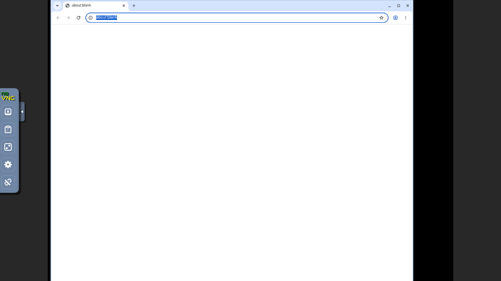

# Private Browser Worker

This optional Docker service provides a dedicated browser for evaluating Washington
State Parks' normal reservation interface. It is a diagnostic tool, not a live
availability connector. It does not create targets, run watches, send alerts,
reserve sites, or hold inventory. The main Camp Finder container is unchanged.

The browser starts on a blank page. An operator can open the normal reservation
site through the private console and inspect a submitted Camping or Roofed search.
No personal browser profile, cookies, or account information need to be copied from
another computer. Unattended access still needs verification and a permitted
access path before a scanner can be enabled. See the
[Washington integration status](washington-state-parks.md).

## Preview on Windows

With Docker Desktop running Linux containers, run this from the repository root
in PowerShell:

```powershell
.\scripts\Start-BrowserWorker.ps1 -ShowPassword
```

The launcher builds and starts a separate `campfinder-browser-local` Compose
project, waits for health checks, and prints the local console address and login.
It does not start or change the main Camp Finder container. Use `-Port 6085` if
6080 is occupied, or `-NoBuild` to reuse an already-built worker image.

The generated password is stored as a Windows DPAPI-encrypted SecureString at
`%LOCALAPPDATA%\CampFinder\browser-worker\console-password.xml`, outside the repo
and cloud-synced appdata. The same Windows user can display it again by rerunning
with `-ShowPassword`. Docker administrators can still inspect container environment
values, so treat Docker access as privileged and do not share full inspection
output. This local credential is unrelated to any reservation account.

Open the printed localhost link and enter the credentials yourself. The browser
starts blank and sends no reservation search automatically. To stop the local
preview without deleting its profile:

```powershell
docker --context desktop-linux stop campfinder-browser-local-browser-1
```

## Install on a Docker Server

Use a Linux Docker engine with Compose v2 and support for unprivileged user
namespaces. The browser runs as `pwuser`, UID/GID 1001, with Chromium's namespace
and seccomp sandboxes enabled. All outer container capabilities are dropped.
Do not disable the sandbox or use a privileged container to fix startup errors.

From the repository root on the server, create `appdata/browser.env` with a
password-manager-generated console password of at least 16 printable ASCII
characters. It must be separate from any reservation account password:

```dotenv
CAMPFINDER_BROWSER_PASSWORD='replace-with-a-long-unique-console-password'
CAMPFINDER_BROWSER_PORT=6080
```

Choose a value that does not contain a single quote when using the quoted dotenv
form above. Restrict the file to the service operator (`chmod 600
appdata/browser.env` on Linux). `appdata` is excluded from Git and Docker build
contexts. Do not put this password in a tracked Compose file or share the output
of `docker inspect` or `docker compose config`, which can reveal environment values.

Build and start only this service:

```bash
docker compose --env-file appdata/browser.env -f compose.browser.yaml up -d --build
docker compose --env-file appdata/browser.env -f compose.browser.yaml ps
```

This standalone Compose file uses its own project and named profile volume. Do not
combine it with the main app's Compose file. Change the port in the private env
file if 6080 is already occupied. The worker does not start automatically after a
server reboot; this is deliberate while the integration is being evaluated.

## Connect Privately

Port 6080 binds only to the Docker host's loopback interface. From your computer,
open an SSH tunnel to the server:

```bash
ssh -N -L 6080:127.0.0.1:6080 user@your-docker-server
```

Open [the private console](http://127.0.0.1:6080/vnc.html?autoconnect=true&resize=scale)
on your computer. Enter username `campfinder` and the console password when the
browser requests HTTP authentication. Use another local tunnel port if necessary.

Only the authenticated web console is published. Raw VNC and browser debugging
ports are not exposed; the inspection API uses a container-local Unix socket.
Do not publish the console directly to the LAN or internet. HTTP Basic credentials
are protected here by loopback plus the SSH tunnel, not by HTTP encryption.
Anyone with console access can control that browser, so keep the password private.



This screenshot comes from the disposable runtime test, not a reservation session.

The console starts with a blank Chromium window. Open the public reservation page
manually only where access is permitted. If a request is denied, stop and resolve
the access issue with the provider. Do not retry through alternate hosts, rotate
identities, export challenge cookies, or automate a verification challenge.

## Inspect a Search

Submit a normal Camping or Roofed search and switch to List view. Leave exactly
one Washington reservation tab open, on `/create-booking/results`. Account pages
and unrelated tabs are not inspected. Select a named park, not All Parks.

The following command reads only the already-rendered result list. Replace the
example park, ID, and dates with the search you submitted. The resource location
ID is the `resourceLocationId` value in that result page's address.

```bash
printf '%s' '{"park":"Bogachiel","resource_location_id":"-2147483639","category":"Camping","arrival":"2027-01-08","departure":"2027-01-10"}' |
  docker compose --env-file appdata/browser.env -f compose.browser.yaml exec -T browser python -m browser_worker.control inspect
```

The example dates are illustrative, not verified availability. Use `Roofed` for a
cabin or yurt search. This inspector compares the submitted URL's park ID,
accommodation category, arrival, departure, and stay length with your request,
then checks the selected category, park name, and rendered result-list heading.
Edited forms with stale results, loading placeholders, missing headings, and
changed pages return errors rather than empty availability.

Output includes the visible result text, child-map count, and whether View more
is present. It always reports `scanner_enabled: false` and `complete_scan: false`.
It does not traverse child maps, expand site details, click Reserve, or validate
checkout eligibility. Keep the output private if it contains personal trip plans.

## Status, Stops, and Recovery

```bash
docker compose --env-file appdata/browser.env -f compose.browser.yaml exec -T browser python -m browser_worker.control status
docker compose --env-file appdata/browser.env -f compose.browser.yaml logs --tail 100 browser
docker compose --env-file appdata/browser.env -f compose.browser.yaml stop browser
```

The worker records a stop when it observes HTTP 401/403 from Washington document
or data requests, or a recognized challenge on a result page. HTTP 429 records
the longer of Retry-After and a one-hour minimum cooldown. These states persist
in the dedicated profile volume and prevent inspection. The worker does not
automatically navigate or retry; the guard does not block a human operating the
console, so stop manual searches too when the provider requests a pause.

After resolving an access issue manually, or after a cooldown expires and a valid
result page is visible, an operator can explicitly clear the guard:

```bash
docker compose --env-file appdata/browser.env -f compose.browser.yaml exec -T browser python -m browser_worker.control acknowledge
```

Acknowledging a guard does not establish permission for unattended requests or
enable monitoring. A restart preserves the profile and guard but opens a blank
browser, rather than resuming a provider page. A closed browser makes health
checks fail. A failed display, console, or VNC process stops the worker. Restart
the service after diagnosing the failure; don't add rapid restart loops.

If startup reports a namespace or seccomp failure, check the host's user-namespace
and security policy. The checked-in seccomp profile includes Chromium's sandbox
syscalls; its provenance and one local change are documented in
[`browser_worker/NOTICE.md`](../browser_worker/NOTICE.md). Do not use
`--no-sandbox`, `seccomp=unconfined`, or `--privileged`.

The named volume contains browser state and is sensitive. It is separate from
the application's SQLite database and configuration exports. Back it up only as
private appdata with the worker stopped. Never upload it with logs or screenshots.
`docker compose ... down` retains the volume; adding `--volumes` deletes it.

## Developer Checks

Build the image, then run the disposable test harness from the repository root:

```bash
docker build -t lynx-camp-browser:local -f browser_worker/Dockerfile .
python scripts/check_browser_worker.py
```

The harness generates a temporary password and a unique Compose project on an
unused loopback port. It removes its own container, network, and profile volume
afterward. It never uses the normal browser profile or the app's database.
Reservation pages in tests are fulfilled locally from synthetic markup; no live
provider search or notification is sent.

Checks cover console asset and WebSocket authentication, cross-origin rejection,
the visible console framebuffer, Chromium sandbox status, profile persistence,
blank restart, category/date matching, loading pages, cooldowns, challenge stops,
and failed browser health. To retain a screenshot of the disposable blank console,
add `--screenshot output/playwright/browser-worker-console.png`.

On November 17, 2026, these checks passed on Docker Desktop's Linux engine:
28 worker tests, the console/security/restart checks, and all 215 existing backend
tests. This does not verify Washington access on the production server, live
availability parsing, complete park traversal, or unattended permission.
