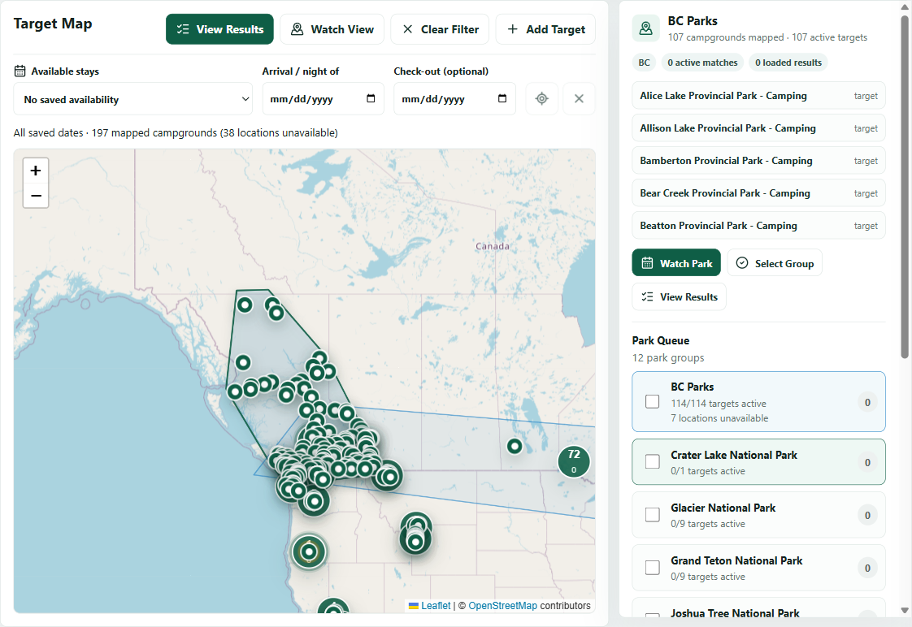

# Canadian Map Locations

BC Parks and Parks Canada reservation catalogs often omit GPS coordinates.
Camp Finder supplements those catalogs with a bundled reference built from
official geographic data. This does not add requests to availability scans or
require a geocoding account.

## What Appears on the Map

- Valid reservation-provider coordinates take precedence.
- BC Parks fallback pins represent the park location published by BC Parks,
  not a particular campsite or campground entrance.
- Parks Canada fallback pins use a representative campsite point from the
  named campground. The campground must also fall within the named park's
  official geographic envelope. Matching a campground name alone is unsafe;
  Green Point, for example, appears in more than one park.
- Reference pins show **Park reference location** or **Campground reference
  location** in their details, with a **Location Source** link.
- Blank, non-finite, out-of-range, and `0,0` coordinate pairs are not map pins.
  Unresolved targets count as **locations unavailable**. They remain available
  to state and park-group watches and in availability results, but cannot be
  selected by drawing a map area.

The November 17, 2026 reference adds 106 BC Parks and 38 Parks Canada locations.
Combined with four coordinates supplied by the reservation catalogs, 148 of the
186 Canadian Camping targets checked have usable map points. The remaining 38
are deliberately left unmapped: some names are ambiguous, some targets span
several campgrounds, and some have no matching official point. This is partial
location coverage, not a claim of complete park or accommodation coverage.



[Mobile map](screenshots/canadian-locations-mobile.png). These screenshots use an
isolated test database containing the public Canadian catalog, with no watches
or availability results. The map also includes 49 bundled US preset locations.

## Upgrade an Existing Installation

1. Back up appdata and update the Docker image using the normal
   [deployment instructions](../README.md#implementation-guide).
2. Keep the existing `/data` volume and restart the container. Startup fills
   missing or invalid Canadian coordinate pairs from the bundled reference.
   Invalid pairs with no reference become null rather than `0,0`.
3. Reload the browser after the new container is healthy. Use a hard refresh
   if an older page is still open.

Valid custom coordinates, target IDs, names, polling settings, watches, results,
and notification configuration are preserved. No database reset, target
deletion, or bulk reimport is required. The upgrade does not start a special
scan or send an alert. Normal background schedules retain their existing state.

## Refreshing the Reference

The runtime file is `backend/app/canadian_locations.json`. It contains only
public location metadata and source URLs, not user configuration. With backend
dependencies installed, run from the repository root:

```bash
python scripts/refresh_canadian_coordinates.py --refresh
```

This reads the two reservation catalogs, BC Parks' protected-area directory,
Parks Canada's accommodation points, and Parks Canada's national park
boundaries. Downloads are cached under ignored `output/location-reference/`.
Paging is bounded and spaced; access denials and rate limits stop the refresh.
Omit `--refresh` to reuse those cached downloads while reviewing matching logic.

Review `output/canadian-locations.json` and the printed unmatched list. Check
same-name parks, representative points, and source URLs before replacing the
bundled snapshot:

```bash
python scripts/refresh_canadian_coordinates.py --output backend/app/canadian_locations.json
python -m pytest backend/tests/test_coordinates.py -q
```

The generation timestamp is the build time, not a promise that cached source
data was downloaded then. No automatic geocoding or fuzzy-name matching is used.
BC names must match uniquely after normalization. Parks Canada campground names
must match within the park envelope; widely dispersed groups are rejected.
Boundaries are used to disambiguate identity, not as invented campground points
or replacements for the dashboard's campground-derived region shapes.

## Verification

Regression tests cover missing and placeholder coordinates, custom-coordinate
precedence, catalog enrichment, repeat startup migrations, and same-name
campgrounds on opposite coasts. A temporary Docker database loaded all 186
public Canadian targets, with legacy missing coordinates represented as `0,0`;
startup produced 148 mapped locations, 38 null pairs, and no zero-point pins.
No production writes, availability searches, reservations, or notifications
were used for this check.

On November 17, 2026 (Pacific), all 453 backend tests passed on Windows and in
Docker with external networking disabled. All 10 frontend tests and the
production frontend build passed. Browser checks at 1440px and 390px confirmed
rendered markers, reference labels, source links, missing-location counts, and
no horizontal page overflow. Production deployment is a separate operator step.

Data sources and attribution are listed in [Third-Party Data](third-party-data.md).
