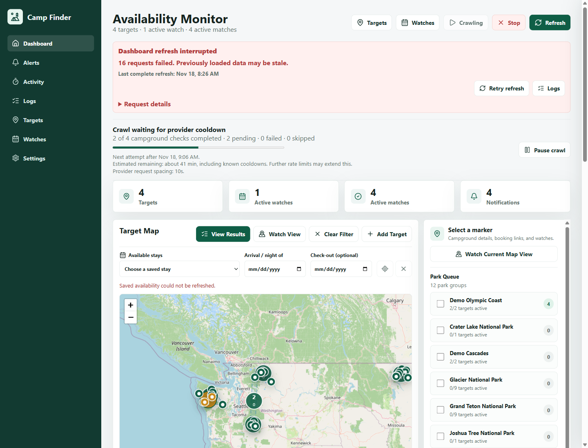

# Dashboard Timeouts

A dashboard warning means one or more reads failed. It does not, by itself, mean the crawler stopped or that the database is corrupt. A provider cooldown is a separate condition: Camp Finder can remain responsive while waiting to contact a reservation provider again.

## Recovering the View

Previously loaded matches stay visible. Check **Last complete refresh**, expand **Request details** for the failing endpoints, and use **Retry refresh** after connectivity returns. The warning clears after a complete successful dashboard refresh. **Logs** opens scan history and provider diagnostics; it is not a viewer for raw container output.

The following screenshots use synthetic campgrounds and browser-intercepted connection failures, not live availability:



[Mobile warning](screenshots/dashboard-timeout-mobile.png)

## What the Server Now Does

- Saves up to 100 matches per database transaction in a worker thread. Large result sets no longer require a separate blocking commit per campsite on the API event loop.
- Waits for an in-progress write to finish before releasing the scan lock on cancellation. Stop is not an immediate database interrupt.
- Marks a stay complete only after all its matches are saved. Resuming a partial stay preserves dismissals and avoids duplicate finding-journal entries.
- Runs only one dashboard refresh cycle at a time. Live polls skip busy ticks; a requested refresh waits and then reads again.
- Logs `Slow database operation: ... took ...s` when a database worker takes at least two seconds, including time waiting for its worker. Logs `API event loop stalled for ...s` when the event loop falls at least two seconds behind. These warnings appear in container output after the delay, not in the scan-event list.

No database reset or manual migration is needed for this update. It does not change provider pacing, cooldowns, saved notification destinations, or watch rules. It also does not eliminate every synchronous database operation or solve host storage/proxy failures.

## Collecting Evidence on Unraid

Replace `campfinder` with the actual container name. From the Unraid terminal:

```sh
docker logs --timestamps --since 2h --tail 1000 campfinder
docker stats --no-stream campfinder
docker inspect campfinder --format '{{json .State}}'
docker inspect campfinder --format '{{json .Mounts}}'
```

Record the time the browser warning appeared, including its timezone. The `--timestamps` flag matters: ordinary access lines have no duration. A `200 OK` can be logged after the browser has already given up, so a list of successful requests does not rule out slow responses. Look for the warnings above, database lock messages, tracebacks, restarts, and an out-of-memory state. Remove secrets before sharing logs; do not share a full container environment dump.

Compare the read-only health URL through the reverse proxy with the app's direct LAN port at approximately the same time. For a container that publishes port 8080 on this host, for example:

```sh
curl --max-time 20 -sS -o /dev/null -w 'HTTP %{http_code}, %{time_total}s\n' http://127.0.0.1:8080/api/health
curl --max-time 20 -sS -o /dev/null -w 'HTTP %{http_code}, %{time_total}s\n' https://YOUR-CAMP-FINDER-HOST/api/health
```

Use the actual published port and hostname. A fast direct response alongside a slow proxied response points toward the proxy/network path; both being slow warrants checking app and host load. A single successful probe does not rule out an intermittent stall or prove writes are healthy.

Check free space, memory, appdata pool placement, backup/mover activity, and whether another container opens the same SQLite database. `/mnt/user/appdata/...` alone does not establish a storage fault. Keep one app instance per database. Before storage changes, stop the container and back up the full appdata directory, including any SQLite journal files. Do not delete the database or its WAL to clear a timeout.

## Verification Scope

On November 18, 2026, an isolated slow-write test reproduced a blocked API event loop before the persistence change and passed afterward. Cancellation, rollback, partial-stay recovery, existing-database behavior, and notification regressions passed in the backend suite. Browser checks verified retained results, expandable errors, retry recovery, and mobile layout using synthetic failures.

This establishes that the blocking-write path was real and is addressed. It does not establish that it was the only cause of a production timeout. Timestamped container logs and direct-versus-proxied timings are still useful if the warning returns after deploying the update.
