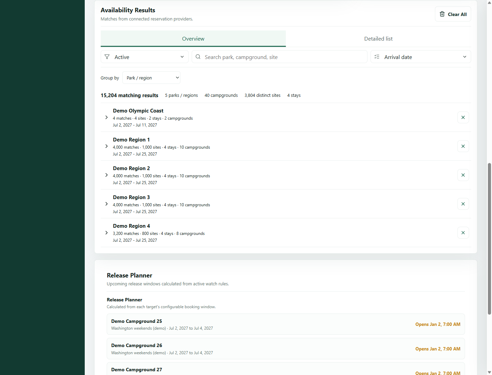

# Browse Large Result Sets

Availability Results opens in **Overview**. Its totals include every saved match
that meets the current filters, not just the most recent 2,000 results. The server
returns counts first; individual campsite records load only when you expand a
stay. Browsing this view does not contact reservation providers or start a scan.

[Mobile overview](screenshots/results-overview-mobile.png)

## Find a Campground or Weekend

Choose **Group by**:

- **Park / region**: expand a park, then a campground, then a stay.
- **Campground**: compare campgrounds directly, then expand their stays.
- **Dates**: start with a check-in/check-out pair, then compare campgrounds.

Groups start collapsed. Each level displays up to 25 rows, with Previous and Next
controls when there are more. Site details are also paged in sets of 25. Closing
a group removes its site details from the page; it does not discard results.

Search, status, and sort apply on the server before grouping and paging. A search
can find an older match even when that match is absent from the Detailed list.
Search is a literal, case-insensitive substring across park, campground, site,
loop, type, watch name, and saved dates. For example, `cabin` narrows the overview
to matching records; it does not launch a cabin search at the provider.

The [map date controls](availability-map.md) filter the same overview. A selected
stay must be covered by one saved result, not assembled from different sites or
nights. Selecting a map park or campground narrows the overview to that location.
Changing the search field clears the map location selection. Result cards and
booking links retain the original checked stay dates.

## Read the Counts

- **Matching results** counts saved watch/site/stay records. Overlapping watches
  can create more than one record for the same site and dates.
- **Distinct sites** counts campground/site pairs once across the filtered set.
- **Stays** counts distinct check-in/check-out pairs, not individual nights.
- **Campgrounds** and **parks / regions** count locations with matching records.

The date span beneath a park or campground is its earliest check-in through its
latest check-out. It is not a promise of continuous availability between them.
Expand the group to see the actual stay dates. No matches means no saved results
meet the filters, not that every campground was searched or is sold out.

Counts refresh with the dashboard, normally every 30 seconds. Use the dashboard
Refresh button for an immediate update. Open pages can change when the crawler
finds or revalidates results. Failed refreshes retain previously loaded groups
with a warning and a Retry button; group dismissal is disabled for stale groups.

## Dismiss a Group

The X beside a park, campground, or date group dismisses its active matches
across **all pages**, including collapsed and unloaded results. The confirmation
shows the matching active count. The action respects search, status, location,
and date filters, and leaves booked records and watches unchanged.

Dismissal uses the maximum result ID seen when the group was read. New records
inserted after that read are excluded. This is not a frozen historical snapshot:
existing records can change status while you browse, so the final dismissed
count can differ from the confirmation. The update is one atomic database
operation. Dismissed records remain available in the Dismissed view and can be
reopened individually.

**Clear All** remains a global dismissal of all active results, regardless of
the current filters. It has its own confirmation.

## Detailed List

**Detailed list** retains the existing individual selection and bulk status
actions. It loads at most 2,000 recent rows, with a visible truncation notice.
Its search, Select Visible, and group dismissal work on those loaded rows only.
Use Overview for complete counts, full-database search, or full-group dismissal.

## Upgrade

Keep the existing `/data` volume. Startup adds the `results_campground_stay`
index automatically, including on populated databases. No database reset,
reimport, new scan, or settings change is required. Watches, notification
preferences, finding history, and handled results are preserved.

The screenshots use a read-only fixture with 15,204 synthetic matches. They do
not represent current bookable inventory or production performance.
