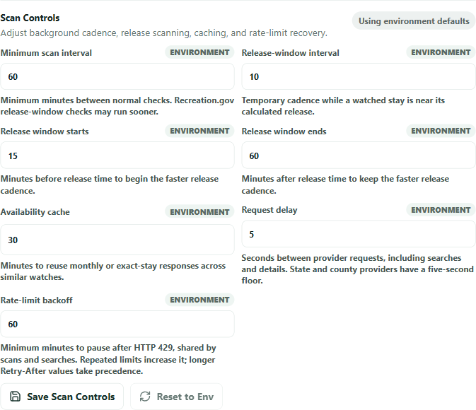
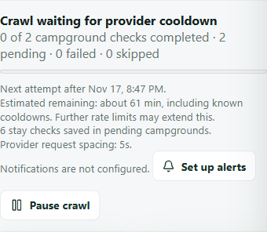

# Throttling and Recovery

Camp Finder uses one scheduler and one request limiter per application process.
Provider adapters borrow request contracts from Camply, but do not run Camply's
polling loop or retry loop alongside our own. This keeps UI searches and watches
under the same pacing and cooldown rules.

## Settings

Open **Settings > Scan Controls**. Changes take effect without a container rebuild
and remain included in the existing configuration export/import workflow.



[Mobile settings](screenshots/shared-scan-controls-mobile.png)

| Control | Effect |
| --- | --- |
| Request delay | Minimum time from the previous request's completion to the next request for that provider; default 5 seconds. State and county providers have a 5-second floor. |
| Rate-limit backoff | Starting cooldown after HTTP 429; default 60 minutes. Repeated limits increase it, and a longer provider Retry-After always wins. |
| Minimum poll interval | Normal interval before repeating a completed campground check; default 60 minutes. |
| Availability cache | Reuse fresh monthly or exact-stay responses across watches; default 30 minutes. Date checkpoints do not depend on this cache. |
| Release window / interval | Optional faster Recreation.gov scheduling near a calculated release. Set either window duration to zero to disable it. Pacing and cooldowns still apply. |

For an unattended regional crawl, keep the hourly repeat interval and start with
5-10 seconds between requests. Increase spacing if limits recur. There is no
published safe rate that we can guarantee, and changing IPs, headers, or restarting
to evade a denial is not part of the recovery workflow. GoingToCamp and UseDirect
access stops still require manual review; this update does not remove them.

Reducing settings does not shorten a cooldown already in effect. A 429 from a
search or source import also pauses background traffic to that provider. The
dashboard, saved results, date filters, and unrelated providers remain available.
Interactive provider searches can take longer while sharing the request lane;
do not repeatedly submit the same operation while it is waiting.
Provider-backed UI reads allow up to five minutes for pacing, matching imports;
local dashboard reads retain their shorter 15-second connection timeout.

## Resuming Dates

After a complete stay has been fetched, filtered, and saved, the scanner checkpoints
its arrival/departure pair and observed result keys. Empty stays are checkpointed
as well. A rate limit leaves the campground pending and preserves those checks.
After the cooldown, the scanner starts with the first unfinished stay instead of
restarting the entire date window. Pause/resume and container restarts retain this
progress. The Logs page records `resumed` events, and the crawl banner displays
the number of saved stay checks in pending campgrounds.

The following mobile example uses a mocked status response; it is not a live
rate limit or measured completion forecast.



There are deliberate exceptions:

- An interrupted stay is retried in full, including its map pages. We do not save partial provider responses.
- A match whose notification was interrupted is rechecked before sending the alert. It may no longer be available.
- Editing dates, filters, accommodation criteria, or the target invalidates previous date progress. Pausing a watch does not.
- A completed cycle clears its checkpoint, so the next normal cycle checks all eligible dates again.

Previously completed dates retain their actual last-seen timestamp. Resuming does
not make old observations look fresh. Missing results are reconciled only after
the watch finishes, using observed keys from both earlier checkpoints and the
resumed portion. A failed or partial scan is not evidence that all old matches
have been booked. User dismissals and bookings remain respected.

ETA subtracts checkpointed work and includes known cooldowns. Exact-stay providers
can make several requests per date, so the initial estimate can be low. Future
limits, notification rechecks, and interactive searches can extend it.

## Deployment and Storage

Deploy the new image with the existing `/data` volume. Startup adds
`scan_checkpoints` to existing databases; no reset, manual SQL, or credential
change is needed. Back up appdata before upgrading. Check **Logs** and the crawl
banner afterward, and leave an existing cooldown or intentional pause in place.

Checkpoints and runtime cooldowns are operational state, not configuration. They
are excluded from JSON configuration exports and included in a full database
backup. Deleting a watch or target removes its checkpoints automatically.
Run one application worker/container per database; the limiter is not a
distributed lock across replicas or separate probe scripts.

## Implementation and Tests

`request_limiter.py` wraps each provider's HTTP method. Provider/tenant keys isolate
traffic, but all calls to the same key share a lock and completion timestamp.
The scanner supplies live settings and persisted exponential cooldowns. A context
variable carries cancellation checks only for the calling scan, so stopping a
scan does not cancel an unrelated UI request. A request already in flight still
finishes or reaches its timeout.

`scan_checkpoints` uses the watch ID as its primary/foreign key. Result writes
precede the checkpoint write: interruption between them retries the date safely
through the existing result upsert. Criteria fingerprints provide a second guard
against reusing incompatible checkpoints. Progress is keyed by date pair, not a
numeric cursor that becomes incorrect when past dates fall out of the window.
Dashboard summary reads use one aggregate query rather than opening a connection
for every pending watch.

Run from the repository root:

```bash
python -m pytest backend/tests/test_shared_limiter.py backend/tests/test_date_progress.py backend/tests/test_notification_recovery.py backend/tests/test_bulk_watch_delete.py -q
```

These tests use synthetic responses and temporary databases. They cover shared
UI/scan cooldowns, tenant isolation, serialization, cancellation, live settings,
restart without a response cache, retained matches, notification recovery,
criteria changes, deletion, and idempotent migration. They do not contact
reservation or notification services and do not establish a provider's safe rate.
