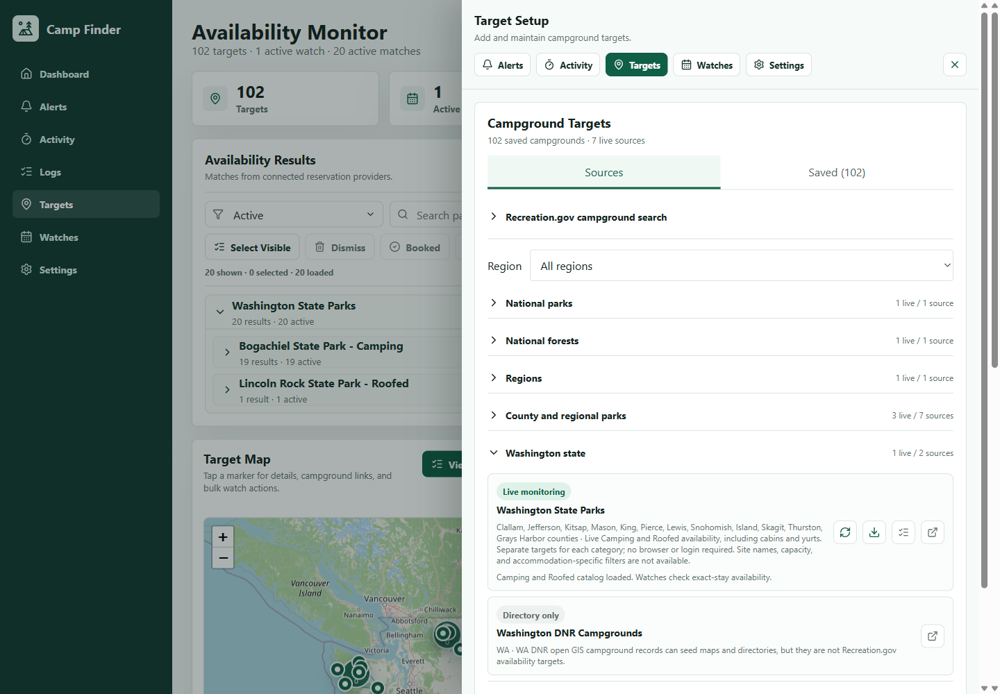
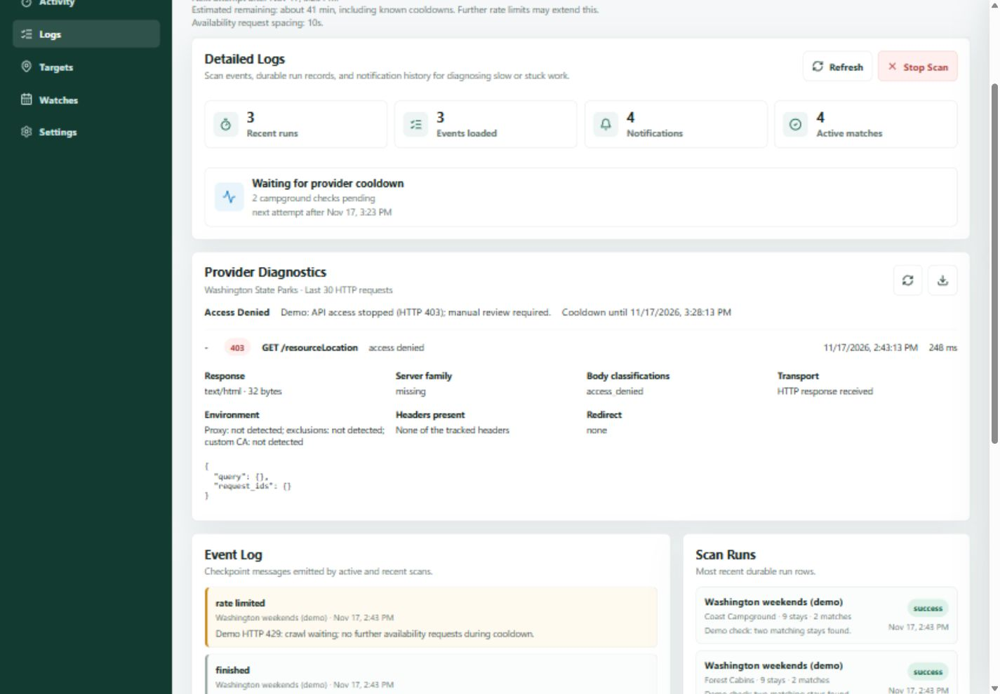

# Washington State Parks Integration

## Status

Washington State Parks supports **live Camping and Roofed monitoring** in the regular Camp Finder backend. It incorporates the successful Camply request behavior and PR #398's root-map/filter workflow while retaining the app's asynchronous scanner, cancellation, and notifications. There is no browser-console requirement, separate worker, or account login.

Local Docker checks on November 17, 2026 discovered 75 Camping and 27 Roofed targets. An exact November 28-30 stay returned 19 Bogachiel campsites and one Lincoln Rock Roofed match. The normal reservation website independently showed Lincoln Rock cabin C7 as Available for those dates. No reservation, cart hold, or real notification was sent during verification.

Production Unraid access, sustained statewide polling, and every park-specific rule remain unverified. A successful local request is not a provider availability guarantee or permission to ignore access controls. The earlier fixed-identity client received 403; the current request profile succeeded without imported browser cookies, proxies, or challenge solving. Existing access stops are intentionally preserved on upgrade.

## Setup

1. Back up appdata with the container stopped, then update the regular Camp Finder image using the [README installation instructions](../README.md). Startup applies additive database changes; no reset or export/import is required.
2. Open **Targets > Sources > Washington state**. Washington State Parks is labeled **Live monitoring**. If an older version saved an access stop, pause Washington watches, wait until its cooldown has elapsed, then explicitly reset the reviewed stop. Check requests the park/accommodation catalogs; Import discovers and saves targets. Neither action makes a reservation.
3. A successful import creates separate Camping and Roofed targets per park when those categories are recognized. Day-use-only locations are excluded. A Washington regional watch with **Include future imports** enabled picks them up automatically; otherwise edit the watch's saved coverage or create a watch for the Washington State Parks group.
4. For Friday and Saturday nights, use Friday arrival and two nights. Leave Site type blank for mixed-category regional watches. For cabin/yurt searches, select the desired **Roofed** targets. `Camping` or `Roofed` filters must match the selected target categories. Individual cabin-versus-yurt type, display names such as C7, loop, and capacity are not available from this endpoint; those filters produce an explicit error instead of silently hiding results.
5. Existing Discord, Home Assistant, and email settings apply to new matches. Review the provider's final rules, party size, equipment, and eligibility before booking. Results are candidates, not reservations or cart holds.

No new environment variable, API key, or browser profile is required. The old diagnostic browser worker has been removed from the repository; see the [retirement guide](browser-worker.md) for existing installations. Do not delete the database to clear an access problem.

### Access Stops and Rate Limits

The connector makes serialized requests with at least five seconds between responses and subsequent requests. Scan requests also honor **Settings > Scan controls**. Each map needs one exact-stay request; a large park can contain several maps. Completion estimates can grow as those maps are discovered. Start with a few parks and a narrow date range before expanding a regional watch.

HTTP 429 waits at least one hour, or longer when Retry-After requires it. The existing crawler also applies its provider-specific cooldown. A 401/403, redirect, or HTML challenge stops API requests until reviewed, even across a container restart. It never falls back to a browser or turns a denial into "no availability." Previously saved results remain intact on failed checks.

Sources shows the saved error and earliest review time. Check and Import are disabled while stopped or cooling down. After resolving access and waiting out the cooldown, **Reset access stop** asks for confirmation. Resetting does not send a provider request, but active watches may resume requests on their next scheduled run. Pause those watches first when you want to make only a manual Check. Logs records scan errors and request stages.

## Implementation and Limits

- Catalog requests use `/api/resourceLocation` and `/api/resourcecategory`, require recognized Camping and Roofed category metadata, and use each location's `rootMapId`. Complete metadata is cached for 24 hours; explicit Check/Import refreshes it. The location endpoint's capitalization matches the observed browser request; that correction is not evidence that it caused or fixes the 403.
- Searches use GET `/api/availability/map`, JSON-encoded `filterData`, booking category 0 or 1, and the requested arrival/departure. Camping uses the upstream tent-equipment default; Roofed omits camping equipment. This does not prove suitability for every RV size or party.
- Each map uses `getDailyAvailability=false` for the requested arrival/departure. Only a single integer status of zero is accepted. The daily calendar is not occupied-night inventory: the verified Lincoln Rock cabin had full-stay status 0 but daily statuses `[0, 3, 3]`. Requiring each daily entry to be zero would incorrectly discard that available cabin. Child maps are traversed completely with duplicate, cycle, and size checks.
- Site names fall back to provider IDs; capacity, facilities, eligibility restrictions, and individual roofed type remain unknown. Party size is one. Review these requirements in the provider's booking interface before reserving. The Lincoln Rock link was verified to prefill Roofed, park, leaf map, arrival, departure, and two nights.
- Result IDs use the catalog root map plus resource ID, so the same resource returned at a different map level does not create another match. Booking links retain the matching map independently and are validated when saved. Older experimental leaf-map result IDs may appear as a new result once; existing target/watch IDs are unchanged.
- Targets and watches are included in normal configuration exports. Runtime denial/cooldown state stays in appdata. Anonymous cookies received directly from the provider stay only in memory, expire normally, and are cleared on reset/restart; no account or browser-cookie import is used.
- The full Camply package is not a runtime dependency. Its Pydantic 1 requirement conflicts with the app's Pydantic 2 stack, and its reviewed connector is Camping-only. The app reuses its `fake-useragent==1.4.0` Chrome header pattern and Accept-Language, with the existing HTTPX client and provider safeguards. This is an adapted integration, not an embedded Camply CLI.

[Camply PR 391](https://github.com/juftin/camply/pull/391) and [PR 398](https://github.com/juftin/camply/pull/398) describe the root-map and filter changes. [Camply attribution](../third_party/camply/NOTICE.md), [GoCamp attribution](../third_party/gocamp/NOTICE.md), and their MIT licenses are included in the repository and Docker image. The retired `/api/resource/details` endpoint is not called, and placeholder capacities are never treated as verified data.

### Reproduce the Adapter Check

The normal app uses its saved stops and scan controls. For a separate developer check, pause Washington watches and inspect the current access state first. From the repository root, with backend dependencies installed:

```sh
python -m scripts.check_washington --live --arrival 2026-11-28 --departure 2026-11-30
```

Update the dates for future tests. This helper has no appdata access and does not send notifications. It checks Bogachiel Camping and Lincoln Rock Roofed, with a maximum of 30 requests and the normal five-second floor. Supply `--not-before` with the existing timezone-aware cooldown timestamp when applicable. Do not use it to bypass an unresolved stop. It exits on failure rather than starting a retry loop. Live responses should not be turned into permanent test expectations; availability changes.



[Camping and Roofed results](screenshots/washington-live-results.png) | [Mobile cabin result](screenshots/washington-live-mobile.png)

These images show the local Docker test instance with real point-in-time availability, not held inventory. Camping and Roofed were scanned through saved watches and produced 20 persisted results. The browser check identified the sole Roofed result as cabin C7; Camp Finder displays its resource ID because the API used here does not supply site labels. Discord and Home Assistant handoff was tested with mocked HTTP responses, not real messages. Sustained polling and production-host access remain separate checks.

## Request Diagnostics

Open **Logs > Provider Diagnostics**, or select the log icon beside Washington State Parks in Sources. The latest 30 HTTP attempts are stored in appdata, newest first, and survive container restarts. There is no new service, environment variable, database replacement, or browser-console requirement. Existing databases use the app-settings table they already have.

Each expandable row includes the endpoint, allowlisted search parameters, status, elapsed time, response size/type, known server family, and coarse body classifications such as `access_denied` or `human_verification`. Header-presence flags include Via, X-Cache, X-Azure-Ref, Set-Cookie, and WWW-Authenticate. The JSON download also records whether a request had anonymous cookies, never their values. Proxy, proxy-exclusion, and custom-CA settings are booleans. A configured proxy is not proof that a request used it; a classification is a clue, not a definitive diagnosis.

The report never retains raw response bodies, cookies, authorization headers, redirect URLs, proxy addresses, exception messages, cart/booking identifiers, or arbitrary query parameters. Request IDs are limited to named correlation headers and constrained hexadecimal/UUID formats. Search dates and public resource IDs remain in the report, so review it before sharing. Runtime diagnostics are excluded from Settings configuration exports; a full appdata backup still contains them.

**Refresh** reads saved evidence. **Download** fetches the latest saved report and downloads JSON. Neither makes a provider request, clears a cooldown, or resumes a stopped source. While Logs is open, the saved report refreshes every 30 seconds when the tab is visible. A refresh error leaves the previous report visible with a stale-data warning.

Requests made before this feature was installed cannot be reconstructed. A saved access stop with an empty history is expected after an upgrade. Do not reset that stop simply to populate the log. After the access issue is reviewed and the cooldown has elapsed, pause Washington watches before an intentional manual Check if you need a single controlled attempt. New 401/403 responses still stop requests; diagnostics failures cannot disable that protection.

### Browser Comparison, November 17, 2026

A normal, unsigned-in Edge session was inspected through its Network panel. No account cookies, HAR, browser profile, or reservation data were exported, and no Reserve action was taken.

| Observation | What it establishes |
| --- | --- |
| GET `/api/resourceLocation` returned network HTTP 200 with `application/json; charset=utf-8`. Both the page's service-worker response and the underlying fetch were inspected. | The public catalog endpoint exists and worked in that browser session; this was not only a cached page rendering. |
| A Camping search at Alta Lake for November 28-29 returned network HTTP 200 JSON from `/api/availability/map`. | The availability endpoint is still in use. The preview contained `mapAvailabilities`, `mapLinkAvailabilities`, and `resourceAvailabilities`; this root map had no individual resource results. It does not establish bookable matches. |
| The browser response included X-Azure-Ref, X-Cache, and Set-Cookie. The request carried cookies. | The browser has session/edge context that the native client does not copy. Header presence does not establish which component denied the native request. |
| The browser supplied sub-equipment, structured party-capacity counts, filters, and transient cart/booking parameters in addition to dates and category. | The experimental client's simpler query still needs full contract validation. Transient session identifiers are not copied into the connector. |

The earlier native catalog attempt returned 403, before detailed diagnostics were installed. Its headers and body were not retained, so the rejection cannot yet be attributed to the origin API, an edge policy, a proxy, authentication, or endpoint capitalization. The existing Docker access stop was preserved during this comparison. Changing the endpoint spelling to match the browser is a contract correction, not an access workaround or a verified fix.

This comparison preceded the successful Camply-profile integration. A denial on catalog discovery happens before date/equipment filtering, so availability parameters alone do not explain it. The current client follows Camply's header generation without a denial-recovery loop. Do not copy challenge cookies, disable TLS checks, or rotate network routes after a denial.

The screenshots below use a synthetic denial in the isolated documentation demo, not a captured provider response.



[Mobile diagnostics](screenshots/washington-diagnostics-mobile.jpg)

## Historical Browser Research

For a separate library comparison without a browser, use the [Camply Docker probe](camply-probe.md). It is a bounded diagnostic tool, not part of scheduled scanning, and does not read or modify Camp Finder appdata. The first November 17 test received HTTP 403 under a fixed application identity. A later, explicitly requested test of pinned PR #398 with Camply's default User-Agent completed in local Docker and returned 19 Bogachiel Camping candidates for November 28-29. Its retired site-details endpoint returned 404 and used the PR's placeholder fallback. This is working candidate retrieval for one stay, not verified Roofed, statewide, or production coverage, and it does not change the native connector's saved access stop.

The reservation workflow was inspected in the owner's existing Edge session on November 17, 2026, after an explicit handoff. Anonymous camping and roofed results loaded there. This does not establish access from a Docker browser or identify why the development browser was denied.

The browser-based prototype was not selected as the scanning architecture and has been [removed](browser-worker.md). It only inspected manually submitted pages and never fed watches or notifications. Historical source is retained in Git; existing private profiles and console credentials are not deleted by the cleanup.

Normal browser searches remain useful for verifying results, but the app has no browser-console dependency. Do not export challenge cookies or replay browser credentials through a denied API.

A local browser helper would require the owner's computer to remain available, so it does not meet the remote-only deployment requirement. The integrated adapter runs entirely in Camp Finder's Docker container; production-host access still needs a check after deployment.

## Interactive Verification

The November 17 inspection used only the normal search interface, with no sign-in, cookie export, direct API replay, notification subscription, reservation, or cart action. These are point-in-time UI observations, not held inventory or proof of unattended access:

- Camping: Bogachiel's Campground list showed Site 2 as Available for November 28-29, 2026, with an enabled Reserve button. Expanded details allowed tents and a van/camper, listed capacity eight, and distinguished `ADA Only: No` from `ADA Accessible: Yes`.
- Roofed: Lincoln Rock's Deluxe Cabins list showed C7 as Available for November 28-30, 2026, with an enabled Reserve button and capacity six. The cabin was labeled ADA accessible; checkout eligibility was not tested.
- The Camping search URL used `searchTabGroupId=0` and `bookingCategoryId=0`; Roofed used `1` for both and omitted camping equipment parameters. These are observed browser-navigation parameters, not a verified API contract.
- Navigation followed region, park, section, and individual site levels. `View more` appeared at regional and campsite levels. Exhausting one page is not a complete inventory scan.
- Switching the form from Camping to Roofed left the previous camping results visible until a new search was submitted. A collector must match the submitted URL category, park, dates, and rendered results to the requested stay, not merely read the current form selection.
- Availability initially remained in a loading-placeholder state. The collector must distinguish loading, explicit empty results, and failures, with bounded waits and cancellation. Blank markup is never proof of no availability.

Observed controls include `park-autocomplete-input`, `arrival-date-field`, `departure-date-field`, `nightsTab`, `nights-field`, `actionSearch`, `list-view-button-button`, and `loadMoreButton`. Map-navigation buttons used `mapLink-button-*`; individual-site results expanded into a named Details region with a separate Reserve button. Follow navigation and detail controls only. Never click Reserve to test whether a site is available.

The provider also exposes a Notify me action. Its account requirements, delivery behavior, and automation interface have not been verified; Camp Finder does not subscribe to those alerts.

## Coverage

- Discover reservable Washington state parks and their overnight accommodation categories dynamically.
- Search complete stays for tent/RV sites, cabins, yurts, and other verified roofed accommodations. Exclude day-use inventory.
- Reuse Washington, park-group, and map-area watches. New imports join existing matching groups only when Include future imports is enabled.
- Use the existing paced crawl, provider-specific cooldown, cancellation, diagnostic events, and Discord/Home Assistant/email notification paths.
- Open the provider's booking page for manual checkout. Availability monitoring does not require implementing account login, cart holds, or payment.

First-come sites, closed loops, and inventory outside the reservation window must not appear as bookable matches. A park directory is useful for discovery, but does not answer whether a specific stay is available.

## Public References

[Washington's reservation instructions](https://parks.wa.gov/passes-permits/reservations/making-reservations) identify GoingToCamp as the booking service. They describe a nine-month reservation window for ordinary stays, distinct last-minute cutoffs by accommodation, and roofed-accommodation minimum stays. ADA-only sites require eligibility. These rules need to be checked against the current provider response before a match is emitted; a generic federal booking window is not appropriate.

The [reservation parks directory](https://parks.wa.gov/passes-permits/reservations/reservation-parks) and [winter schedule](https://parks.wa.gov/find-activities/winter-schedule) describe seasonal differences. Do not assume that every park or loop accepts reservations year-round.

[OpenCamp](https://github.com/opencamp-hq/cli) targets Recreation.gov and does not supply a Washington State Parks connector.

[Camply's GoingToCamp implementation](https://github.com/juftin/camply/blob/9c4eee52c51bd734ddd72c223c0a4fd0f6f066b0/camply/providers/going_to_camp/going_to_camp_provider.py) is a useful public contract reference. The initial review at commit `9c4eee52c51bd734ddd72c223c0a4fd0f6f066b0` identified the gaps below. The current adapter adds root-map discovery, Roofed searches, complete traversal, and exact-stay validation rather than embedding that implementation unchanged:

- [Issue 377](https://github.com/juftin/camply/issues/377) reports a Washington discovery failure when maps have no resource-location ID. Validate the location's `rootMapId` relationship instead of joining every map by location ID.
- The reviewed search fixes `bookingCategoryId` to `0` and limits discovery to named camping categories. This does not establish roofed-accommodation coverage. Discover and verify the applicable categories and equipment requirements.
- The reviewed traversal visits the root map and one additional level. Verify the full map hierarchy, including deeper children, repeated links, and cycle detection.
- Its availability parser accepts the first status entry with value `0`. Verify what each status and array entry means for the requested full stay, rather than copying that assumption.
- Its request wrapper selects a browser user agent. Do not use identity rotation or challenge-token reuse to work around access denial.

Public source code is a starting point for contract research, not evidence that current Washington responses match it or that unattended requests are permitted.

### GoCamp Review

[peckjon/gocamp](https://github.com/peckjon/gocamp) was reviewed on November 17,
2026 at commit `21d1000bef6df9f1d53a12881599ad60a87661fd`. It is an MIT-licensed,
Washington-specific Python HTTP wrapper, not a browser driver. Its API structure
is useful reference material, but it has not been installed or run against the
provider in this project.

The [current search code](https://github.com/peckjon/gocamp/blob/21d1000bef6df9f1d53a12881599ad60a87661fd/app.py)
fixes `bookingCategoryId` to camping and party size to one, passes the same value
for equipment and sub-equipment, and expects older map fields. It calls
`requests.get/post(...).json()` without timeouts, HTTP status checks, pacing, or
Retry-After handling. Its booking helper creates a link; it does not reserve sites.
Do not infer working cabin coverage from the category menu in its console example.

[Issue 3](https://github.com/peckjon/gocamp/issues/3) records upstream schema changes,
including missing `mapLinkLocalizedValues`, and a 2022 comment pointing to Camply's
replacement implementation. These historical reports do not establish today's
service behavior. The latest repository change is a September 2025 contributor
workflow; the last `app.py` change is July 2021.

GoCamp is an additional contract reference, not a drop-in connector or a solution
to denied access. The integrated adapter uses direct API requests; the retired
browser prototype is not part of that path.

## Further Validation

The integration now has local Docker discovery, a two-night Camping check, a browser-confirmed two-night cabin match, and automated watch/notification coverage. The checklist below remains useful for extending accommodation filters, auditing other parks, or validating a different deployment host. It is not a claim that every item has been live-tested.

1. Establish a permitted API/feed or browser workflow, authentication requirements if any, request limits, and caching guidance. Keep any credentials outside Git. Resolve the observed denial before unattended testing; do not switch request routes to evade it.
2. Validate discovery against current campground, root-map, and accommodation-category records. Preserve provider-qualified IDs without changing existing federal or county IDs.
3. Verify at least one tent/RV stay and one cabin/yurt stay against the normal booking interface. Include a sold-out stay, partially available stay, closed period, and dates outside the release window. Check minimum stays, capacity, equipment, and eligibility restrictions.
4. Confirm that every occupied night belongs to the same campsite. Validate pagination and nested maps completely before treating a scan as successful. Unknown or partial responses must preserve existing matches and report an error, not return an empty success.
5. Route every HTTP request, including discovery and detail lookups, through serialized pacing and the scanner's cancellation/progress gate. Cache stable metadata. Honor Retry-After and persisted provider-specific cooldowns; stop on access denial or a login/challenge page.
6. Add fixture tests for malformed responses, unknown statuses/categories, missing maps, duplicates/cycles, full-stay rules, cancellation, and cooldown behavior. Cover regional import, watch expansion, notification deduplication, and backup round trips with isolated stores and fake notifications.
7. Verify booking links with the selected park, arrival, departure, and accommodation. Do not claim date-prefill support until tested. Test the target import and watch flows at desktop and mobile widths.
8. Run the backend suite and frontend build, perform a bounded read-only deployment check through the permitted access path, and record the verification date and limits. Only then change the source to `ready`, update user documentation, and capture screenshots.

## Access Inquiry Draft

This draft has not been sent. The official [Washington State Parks information center](https://parks.wa.gov/passes-permits/reservations) lists `infocent@parks.wa.gov`; [Camis](https://www.camis.com/contact) also has an integration inquiry contact form.

Subject: Read-only reservation availability integration for Washington State Parks

Hello,

I maintain a self-hosted campground availability monitor for personal trip planning. I would like to include Washington State Parks camping and roofed accommodations alongside other reservation systems.

Is there an approved API, data feed, or integration program for retrieving campground metadata and checking complete-stay availability? The application would cache metadata, serialize requests, honor your polling limits and Retry-After responses, and link visitors to your website for booking. It would not create reservations or access customer records.

An initial fixed-identity API request received a denial. Bounded Docker checks with Camply-compatible headers and anonymous session cookies subsequently returned Camping and Roofed matches. Sustained polling has not been verified. Please advise on the supported access method, any credentials or approval required, acceptable polling and caching intervals, and coverage of cabins and yurts as well as campsites.

Thank you.
